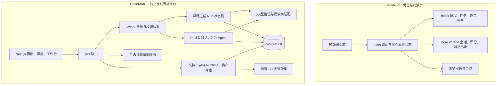
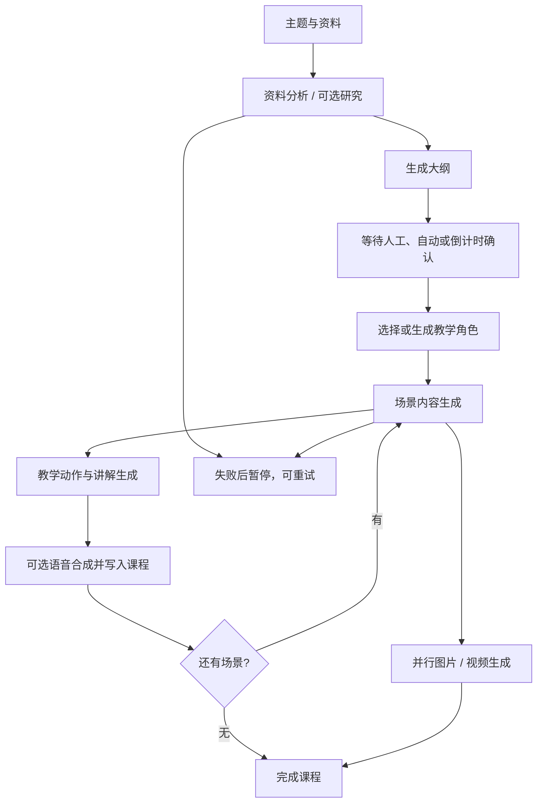
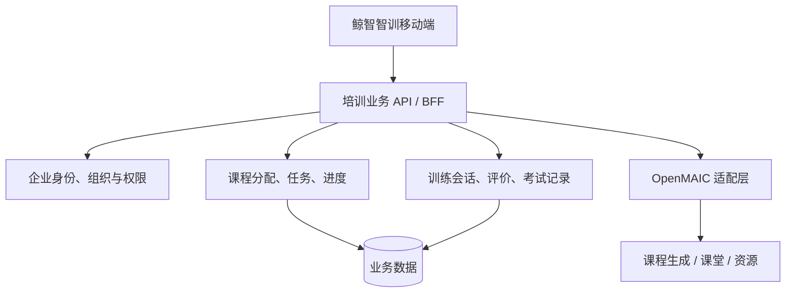
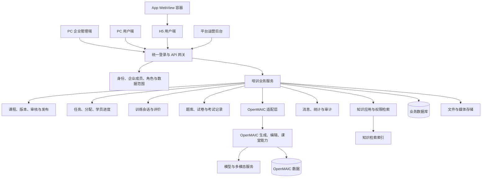

# ola-training 项目分析与平台建设方案

本报告分两部分：第1—9节是现有源码分析；第10—20节依据用户进一步确认的目标，分析多企业培训平台的可行性、OpenMAIC 集成方式及建设范围。目标已确认：现有 frontend 是移动 H5 用户端；新增 PC 用户端与 PC 管理端；App 首期嵌入现有 H5；多家企业各自管理且数据隔离。

分析日期：2026-10-15。范围：当前工作目录中的 frontend 与 OpenMAIC。

本报告依据本地源码、配置、文档、目录统计和实际执行的构建检查。覆盖整体架构与主要调用链，并深入检查移动端业务实现；不等同于对 OpenMAIC 每行代码的审计，也不代表全量测试或真实模型调用通过。未修改业务代码，未安装依赖，未启动数据库或调用收费模型。

## 1. 主要判断

这里包含两套独立应用，而不是已经联通的全栈培训产品：

| 目录 | 定位 | 当前状态 |
| --- | --- | --- |
| frontend | “鲸智智训”移动端岗位培训前端，覆盖学、训、考、任务、助手和个人成长 | 可交互的业务演示，数据主要来自静态 mock |
| OpenMAIC | AI 多智能体互动课堂平台，包含网页、服务端 API、后台任务、持久化和 SDK | 规模较大的独立平台；本机尚未安装其依赖，运行结果未验证 |

判断依据：前端只依赖 React、React DOM、图标库，没有 API 客户端或 OpenMAIC 包引用，Vite 配置也没有后端代理。OpenMAIC 的 pnpm workspace 不包含 frontend。[source:frontend/package.json] [source:frontend/vite.config.ts] [source:frontend/src/App.tsx] [source:OpenMAIC/pnpm-workspace.yaml]

从产品设计看，前端已呈现“岗位培训”的业务结构；OpenMAIC 提供内容生成与互动授课能力。把两者组合成正式产品，还需要企业身份、课程分配、任务执行、训练评价、考试记录与统计等业务层。该组合是后续方案，不是当前已实现的关系。

## 2. 目录、规模与技术栈

```text
ola-training/
├─ frontend/                 独立 Vite 应用
│  ├─ src/                   页面、mock、4 个 CSS 文件
│  ├─ public/assets/         本地插画与课程封面
│  └─ dist/                  已存在的构建产物，不代表当前源码构建通过
└─ OpenMAIC/                 独立 Git 仓库、Next.js 应用
   ├─ app/                   页面与 API
   ├─ components/            课堂、工作台、编辑器等 UI
   ├─ lib/                   生成、对话、播放、持久化等逻辑
   ├─ packages/@openmaic/     六个能力包
   ├─ packages/docs/         独立文档站
   ├─ render-service/        独立视频渲染服务
   ├─ tests/、e2e/、eval/     单测、浏览器测试与模型评估
   └─ scripts/、.github/     构建与持续集成
```

扫描排除了 .git、node_modules、dist、.next 和 .codegraph。按 ts/tsx/js/mjs/css/py 扩展名统计，frontend 为 8 个文件、396 行；OpenMAIC 为 3,141 个文件、714,022 行，找到 1,215 个文件名含 .test. 或 .spec. 的文件、78 个 API route.ts。统计含测试、声明、第三方衍生源码与可能的生成文件，不能当作纯业务代码量或有效测试数量。前端 CSS 和 JSX 大量压在长行中，行数明显低估复杂度。

| 项目 | 栈与工程约束 |
| --- | --- |
| frontend | React 19、TypeScript 5.7、Vite 6、lucide-react；npm 锁文件；TypeScript strict |
| OpenMAIC | 本地包版本 1.2.0-rc.2；Next.js 16.3.3、React 19.2.3、TypeScript 5、Tailwind 4、Zustand；pnpm workspace |
| AI 与课堂 | AI SDK、Pi agent runtime、LangGraph；支持多提供商和多模态的配置与适配代码 |
| 存储 | PostgreSQL；服务端文档、学习运行记录、资产注册与字节存储；可选 S3 |
| 验证 | Vitest、Playwright、ESLint、Prettier、评估脚本、GitHub Actions |

以上为检出代码声明的版本与能力，未进行联网版本核验。[source:frontend/package.json] [source:frontend/tsconfig.json] [source:OpenMAIC/package.json] [source:OpenMAIC/vitest.config.ts]

## 3. 当前架构



两块之间目前没有调用关系。前端主入口加载 App 和四层样式；App 负责路由、通用组件、全部页面和大部分交互。[source:frontend/src/main.tsx] [source:frontend/src/App.tsx]

OpenMAIC 启动钩子负责配置校验、后台生成 Runner、Agent Runner、资料提取和关闭时资源清理。应用层浏览器通过 HTTP 存储客户端访问服务端，而不是把课程主数据直接存在 IndexedDB。[source:OpenMAIC/instrumentation.ts] [source:OpenMAIC/lib/persistence/bootstrap.ts]

## 4. frontend 功能与实现程度

| 模块 | 已实现交互 | 数据及能力边界 |
| --- | --- | --- |
| 首页 | 轮播、待办入口、继续任务、推荐课程、消息入口 | 待办数量、期限与上次学习时间固定 |
| 课程中心 | 学/训/考切换、训练方式、分类、搜索、完成状态、排序切换 | 过滤静态数组；“最新排序”只是数组反转 |
| 课程详情 | 目录、介绍、评价、产品信息、跟读轮次、评价维度翻面 | 多处内容是共享模板，未绑定真实课件 |
| 任务中心 | 待办/已完成、名称搜索、进行中筛选、详情阶段切换 | 任务进度来自 mock，不随学习结果更新 |
| 学习 | 章节选择、下一章、完成按钮、播放状态 | 无真实视频播放器；完成仅改变组件内状态 |
| 人机/跟读/演讲训练 | 文字输入、模拟语音输入、切换角色、话术提示、结束 | 固定回复；浏览器 TTS 可朗读；无真实录音、ASR 或训练模型 |
| 训练复盘 | 分析、话术回顾、秘籍、重新训练 | 86 分、对话与评语固定，不读取真实训练过程 |
| 考试 | 五类题型、答题卡、上一题/下一题、提交确认、本地判分、解析 | 共用五题；无倒计时、次数控制、服务端成绩记录 |
| 鲸小智 | 提问、关键词意图分类、结果跳转、知识应用、新会话/历史会话 | 规则匹配和固定回复，没有真实知识检索或 LLM |
| 我的 | 排行榜类型/组织/月筛选、成长评价、课程评分、训练历史、统计 | 大多数指标模拟；评分可本地保存 |
| 搜索与消息 | 搜索课程、打开消息、标记已读 | 搜索本地数组；已读状态可本地保存 |

核心实现集中在 [source:frontend/src/App.tsx]；类型和演示数据集中在 [source:frontend/src/mock.ts]。

### 4.1 数据模型

- Course：课程 ID、kind（learn/train/exam）、封面、标题、时长、数量、进度、分类、训练 subtype。
- Task：起止日期字符串、状态、完成数、总数、学训考数量、courseIds。
- Question：题型、题目、可选项、标准答案数组。
- Message：发送方、文本、显示时间。
- ChatSession：从 localStorage 的消息 key 和首条用户消息派生的历史会话摘要。

现有数据包含 14 门课程、4 个任务、6 个知识应用、5 道共享试题和6名榜单成员。缺少独立课时模型、训练场景模型、学员课程进度、考试批次/作答记录、评价量表与组织权限模型。[source:frontend/src/mock.ts] [source:frontend/src/App.tsx]

### 4.2 状态、路由和持久化

路由为自定义 hash 路由。主入口为 /home、/courses、/whale、/tasks、/my；详情包括 /task/:id、/course/:id、/content/:id、/training/:id、/recap/:id、/exam/rules/:id、/exam/quiz/:id、/exam/result/:id，以及助手和个人中心子页面。[source:frontend/src/App.tsx]

组件内 useState 保存筛选、章节、作答、训练消息等；页面卸载或刷新后通常丢失。localStorage 保存 chat-*、course-ratings、messages-read；sessionStorage 暂存助手首页带入的首条提问。没有统一业务 Store，也没有服务端作为数据权威。

### 4.3 视觉工程

采用最大 430px 的手机画布、五栏导航、固定底部操作、安全区留白、品牌蓝和公共卡片组件。四层 CSS 按公共、详情、个人/助手、修正依次加载。已有视觉和交互规范，是后续延续产品风格的依据；多层覆盖和压缩书写会增加定位样式问题的难度。[source:frontend/src/styles.css] [source:frontend/src/details.css] [source:frontend/src/social.css] [source:frontend/src/overrides.css] [source:frontend/STYLE-GUIDE.md]

## 5. OpenMAIC 核心模块

### 5.1 服务端课程生成

经典生成入口由首页的生成客户端启动；POST /api/generation-runs 经过身份解析、请求大小与输入校验后创建任务，返回 202。后台 Runner 执行任务，浏览器订阅事件并发送确认或重试命令，不负责逐步驱动生成。[source:OpenMAIC/app/page.tsx] [source:OpenMAIC/app/api/generation-runs/route.ts] [source:OpenMAIC/lib/server/generation/run/start.ts] [source:OpenMAIC/lib/server/generation/run/runner.ts]



状态包括 preparing、outlining、awaiting_outline_confirmation、generating、paused、completed、ended。步骤 checkpoint、事件和状态通过事务提交，租约代次用于阻止失去租约的 Worker 写回。失败重试与媒体单独补做已有实现。这是本项目最值得复用的复杂基础能力之一。[source:OpenMAIC/lib/server/generation/run/types.ts] [source:OpenMAIC/lib/server/generation/run/plan.ts] [source:OpenMAIC/lib/server/generation/run/engine.ts] [source:OpenMAIC/lib/server/generation/run/store.ts]

### 5.2 课堂对话、播放与工作台

课堂由 /classroom/[id] 承载，涵盖课件场景、教学动作、语音与白板等模块。Pi 课堂对话默认开启，POST /api/chat/pi 调用服务端 Director Loop。代码同时保留 LangGraph 编排与旧对话路径，不能因为存在 LangGraph 依赖就把它认作唯一主运行时。[source:OpenMAIC/app/classroom/[id]/page.tsx] [source:OpenMAIC/app/api/chat/pi/route.ts] [source:OpenMAIC/lib/chat/pi/director-loop.ts] [source:OpenMAIC/lib/orchestration/director-graph.ts] [source:OpenMAIC/lib/config/feature-flags.ts]

后台工作台 Agent 使用 PostgreSQL 协调任务认领、租约、取消、事件顺序和恢复；连接生命周期不决定任务生命周期。工具覆盖课程、资料、课件编辑、联网能力与技能等。/workspace 检查工作台开关与运行条件，不满足时跳转首页。工作台能力不是安装后无条件开启。[source:OpenMAIC/lib/server/agent-runtime/runner.ts] [source:OpenMAIC/app/workspace/page.tsx] [source:OpenMAIC/lib/config/feature-flags.ts]

### 5.3 SDK 分层

| 包 | 职责 |
| --- | --- |
| @openmaic/dsl | 课程、场景、课件元素、动作的数据契约；校验、规范化、版本迁移 |
| @openmaic/generation | 提示词资源和生成原语；由调用方注入模型调用函数 |
| @openmaic/storage | KV、文档、学习 Runtime、资产的可替换存储实现 |
| @openmaic/importer | PPTX 解析、形状与序列化相关能力；需注意浏览器和 Node 边界 |
| @openmaic/renderer | 只读课件渲染 |
| @openmaic/editor | 编辑事务、撤销重做、React 编辑交互和 UI，依赖 renderer 与 dsl |

DSL 是共享契约基础；生成包不负责选择模型或持久化；渲染与编辑是单向依赖。这种分层有利于局部复用，但接入 frontend 仍需样式、宿主状态和资源解析适配。[source:OpenMAIC/packages/@openmaic/dsl/README.md] [source:OpenMAIC/packages/@openmaic/generation/README.md] [source:OpenMAIC/packages/@openmaic/storage/README.md] [source:OpenMAIC/packages/@openmaic/importer/README.md] [source:OpenMAIC/packages/@openmaic/renderer/README.md] [source:OpenMAIC/packages/@openmaic/editor/README.md]

### 5.4 存储与身份

应用的课程文档、学习会话/答题/播放记录与资产，通过 /api/persistence 等接口存入服务端。包级仍有浏览器后端，不能据此推断当前应用仍默认浏览器持久化。存储包 README 中关于默认后端的部分叙述与当前应用代码存在时间差，应以应用启动和 bootstrap 为准。[source:OpenMAIC/lib/persistence/bootstrap.ts] [source:OpenMAIC/lib/persistence/server-provider.ts] [source:OpenMAIC/packages/@openmaic/storage/README.md]

Owner 身份默认可使用匿名 cookie；支持单用户、共享团队与宿主注册认证方法。ACCESS_CODE 是部署入口控制，不能替代企业员工账号、角色和组织权限。宿主认证目录目前只有说明，需要由产品方实现会话或可信网关身份接入。[source:OpenMAIC/middleware.ts] [source:OpenMAIC/lib/server/identity/registry.ts] [source:OpenMAIC/lib/server/identity/resolve.ts] [source:OpenMAIC/lib/server/identity/host/README.md]

资产字节可存 PostgreSQL 或配置 S3。实例密钥用于保护保存的提供商凭证，需与数据库一起保留；资料持久化还涉及 data 目录，多实例需要一致的密钥与共享资料存储策略。[source:OpenMAIC/lib/persistence/asset-byte-store.ts] [source:OpenMAIC/.env.example]

### 5.5 模型、知识与导出

模型按服务商和能力槽位配置，支持不同环节选择不同模型、锁定和用户自带凭证策略。配置由启动阶段校验，避免运行到一半才发现声明错误。[source:OpenMAIC/openmaic.example.yml] [source:OpenMAIC/lib/server/model-config/runtime.ts] [source:OpenMAIC/lib/server/model-config/resolve-slot.ts] [source:OpenMAIC/instrumentation.ts]

有文档切分、摄取和知识索引抽象，当前可见导出包含 InMemoryLexicalIndex。它证明存在 RAG 基础组件，不证明已有满足企业需求的持久向量库、知识审核、增量更新和部门权限过滤。[source:OpenMAIC/lib/rag/index.ts]

有 PPTX/离线课堂/视频等导出模块。MP4 渲染是可选的独立服务，主应用提交自包含 HyperFrames 项目，由 Chromium 和 FFmpeg 渲染。未配置时可退回项目 ZIP。渲染服务相信应用代理传来的 owner 头，因此部署时必须维持其网络信任边界。[source:OpenMAIC/lib/video-export/index.ts] [source:OpenMAIC/render-service/README.md] [source:OpenMAIC/docker-compose.yml]

## 6. 已确认的问题与风险

以下将演示边界和具体逻辑问题分开理解：固定数据本身符合当前 README 定位，但若作为正式业务交付，必须补齐。

| 优先级 | 发现 | 直接影响与证据 |
| --- | --- | --- |
| P1 | 学习完成、训练结束、考试提交都不更新统一进度 | 完成操作后课程/任务/个人统计仍保留 mock 值，核心业务闭环缺失。LearnContent、TrainingChat、ExamQuiz 与 mock 互不回写。[source:frontend/src/App.tsx] [source:frontend/src/mock.ts] |
| P1 | 考试成绩由 URL score 参数显示，答案也在前端 | 修改地址即可展示任意分数；正式成绩必须由服务端按 attemptId 查询。[source:frontend/src/App.tsx] |
| P1 | 问答题使用字符串完全一致判分 | 语义正确但措辞不同的回答会被判错；空格、标点也影响结果。应区分客观题规范化和主观题评分量表。[source:frontend/src/App.tsx] |
| P2 | 考试题量与课程元数据不一致 | exam-2 声明8题、exam-3声明6题，但所有考试共用5题；规则固定30分钟，和课程时长也有差异。[source:frontend/src/mock.ts] [source:frontend/src/App.tsx] |
| P2 | 训练复盘与真实消息不关联 | 训练过程中输入任何内容，复盘仍展示固定86分和固定对话；历史列表是由课程数组合成的记录。[source:frontend/src/App.tsx] |
| P2 | 演讲训练没有独立流程 | 只有 follow subtype 被特殊处理，speech 进入通用“人机训练”逻辑，详情标题也沿用人机训练。[source:frontend/src/App.tsx] |
| P2 | 无效 ID 被静默替换 | getCourse/getTask 找不到 ID 就返回第一条数据；错误链接会显示不相关内容，而非不存在页面。[source:frontend/src/App.tsx] |
| P2 | 阶段锁定只有文案 | TaskDetail 可切换所有阶段并打开课程，“待解锁”没有执行限制。[source:frontend/src/App.tsx] |
| P2 | 默认阶段选择不完整 | firstOpen 只在 learn/train 中选择；学习和训练都完成或任务已完成时，也不会自动定位考试/结果。[source:frontend/src/App.tsx] |
| P2 | localStorage 读取只捕获 JSON 解析错误，未校验结构 | 合法 JSON 若类型错误可能在 .find/.filter 等处异常；写入未处理存储禁用或配额错误。[source:frontend/src/App.tsx] |
| P2 | 日期、倒计时、考试次数为固定文案 | 随日期推移会失真，无法执行超时交卷或限制重考。任务3起始日尚未到，也未实现可用期校验。[source:frontend/src/App.tsx] [source:frontend/src/mock.ts] |
| P2 | 学习内容未按课程绑定 | 多个课程复用固定章节标题与学习资料，用户选择的课程和实际内容可能不一致。[source:frontend/src/App.tsx] |
| P3 | 页面与业务逻辑集中在一个 App 文件 | 修改训练、考试或路由容易影响无关模块；长行 JSX/CSS 增加 review 与维护成本。[source:frontend/src/App.tsx] |
| P3 | 弹层和纯图标按钮的可访问性不完整 | 代码未普遍提供 dialog 语义、焦点圈定/恢复、Escape 关闭或按钮名称；需结合浏览器与读屏测试验证。[source:frontend/src/App.tsx] |

另外，返回逻辑只检查 history.length，不能保证上一页属于当前应用；首页消息红点也没有读取已读集合。建议在路由与消息模型统一时一并处理。[source:frontend/src/App.tsx]

OpenMAIC 已有 SSRF 防护、固定连接、内容清理、配额、Owner 访问边界和大量相关测试，但本次未全量验证，不能由文件存在推断安全审计通过。[source:OpenMAIC/lib/server/ssrf-guard.ts] [source:OpenMAIC/lib/server/provider-fetch.ts] [source:OpenMAIC/lib/server/sanitize-scene-content.ts] [source:OpenMAIC/lib/persistence/asset-quota.ts]

## 7. 工程质量与实际验证

### 7.1 本次实际结果

| 检查 | 结果 |
| --- | --- |
| 当前 Node | v23.9.0；满足 OpenMAIC 声明的最低版本，但与项目 .nvmrc/CI 的 Node 22 不同 |
| 当前 pnpm | 10.26.2；OpenMAIC packageManager 声明10.28.0，存在工具版本差异 |
| frontend npm run build | 失败：当前 node_modules/.bin 缺少 Windows 可执行入口，无法找到 tsc |
| 直接 node 执行 TypeScript tsc -b | 通过，证明当前前端类型检查通过 |
| 直接 node 执行 Vite build | 失败：缺失 @rollup/rollup-win32-x64-msvc 原生可选依赖 |
| OpenMAIC 依赖 | node_modules 不存在，未执行安装、构建、Vitest、Playwright 或真实模型生成 |
| 浏览器与设备检查 | 未执行，不能确认实际布局、麦克风、语音或端到端运行通过 |

前端失败指向依赖安装的 Windows 适配问题，不能当成 TypeScript 业务代码错误。可能与依赖目录跨平台复制或安装不完整有关，具体来源未确认。建议下一步使用锁文件重新安装，验证 npm ci 后再运行 npm run build；本次未自动删除依赖或改动锁文件。

### 7.2 测试与仓库状态

frontend 没有测试脚本，也未找到测试文件；目前主要依靠类型检查。OpenMAIC 有单测、存储契约、浏览器测试、渲染服务独立检查和模型评估；CI 同时涉及格式、Lint、类型、国际化键、包构建与版本一致性。存在这些检查不代表当前检出状态已通过。[source:frontend/package.json] [source:OpenMAIC/.github/workflows/ci.yml] [source:OpenMAIC/.github/workflows/storage-pg-contract.yml] [source:OpenMAIC/vitest.config.ts] [source:OpenMAIC/playwright.config.ts]

当前顶层目录与 frontend 没有发现自己的 .git，Git 向上发现的仓库根位于项目之外，后续提交前需要先明确仓库边界。OpenMAIC 有独立 .git，检查时存在13个头像图片、两个 shell 脚本的已跟踪改动；本次未修改这些文件，尚未判断是内容修改、文件模式还是换行差异。

## 8. 启动与维护说明

### frontend

在 frontend 目录中执行 npm ci，再执行 npm run dev。Vite 配置端口4173，若占用以终端实际输出为准。生产构建 npm run build；静态预览 npm run preview。hash 路由减少静态部署的路径重写需求；但资源函数硬编码 /assets/，若部署到子路径，需要同时处理 Vite base 和资源路径。[source:frontend/package.json] [source:frontend/vite.config.ts] [source:frontend/src/mock.ts]

### OpenMAIC

建议按 .nvmrc 使用 Node 22，并遵循 engines 的最低22.19.0要求，使用声明的 pnpm 版本。步骤为：

1. 在 OpenMAIC 目录执行 pnpm install --frozen-lockfile，postinstall 会构建 workspace 包。
2. 从 .env.example 复制 .env.local；从 openmaic.example.yml 复制 openmaic.yml，按实际服务商填写凭证和槽位。
3. 使用现有 PostgreSQL16，或运行 pnpm db:up；配置 DATABASE_URL。
4. 执行 pnpm dev；正式构建 pnpm build 后 pnpm start。
5. 若需要 Pro 工作台，核对 NEXT_PUBLIC_PRO_WORKBENCH_ENABLED 与 OPENMAIC_AGENT_RUNTIME_ENABLED 等开关；public 开关涉及构建时配置。
6. MP4 按需启用渲染服务；基础课堂不要求此服务。

主应用需要常驻 Node 服务和数据库；当前版本的持久任务架构不能简单按纯静态站点或短生命周期函数部署。Docker Compose 已提供部署配置；备份需覆盖数据库、实例密钥和资料目录/对象存储。[source:OpenMAIC/package.json] [source:OpenMAIC/README-zh.md] [source:OpenMAIC/.env.example] [source:OpenMAIC/docker-compose.yml] [source:OpenMAIC/next.config.ts]

## 9. 后续整合建议

若目标是把“鲸智智训”做成真实产品，建议保留移动端业务入口，把 OpenMAIC 当内容与课堂能力层，再补业务服务。先接通一个小闭环，比一次性搬入完整工作台更容易验证。



这是建议架构。BFF 可以先实现为同一服务中的业务模块，无需为了分层立即拆成独立微服务。

### 9.1 数据契约优先

补充 User/Organization/Role、Course/Chapter/Content、Enrollment/Progress、TaskAssignment/TaskStage、TrainingScenario/TrainingSession/Turn、Rubric/Evaluation、ExamPaper/Question/Attempt/Answer、KnowledgeApp/Resource 等模型。明确前端 Course ID 与 OpenMAIC Stage ID 的映射；正式训练对话、课堂聊天和知识应用会话应有各自业务语义。

任务完成度应由分配记录和学员实际完成状态派生。考试成绩、通过状态、训练评价归服务端；前端只显示结果。关键写操作需要幂等，避免重复交卷、重复生成、重复计费。

### 9.2 优先复用的接入点

| 接入点 | 用途 | 边界 |
| --- | --- | --- |
| OwnerAuthentication | 接企业身份与稳定 ownerId | 仍需自己的组织/角色授权策略 |
| PersistenceHooks、LibraryProvider | 控制课程创建、课程库可见性与资产分配 | 不能自动获得完整培训业务模型 |
| GenerationRunHooks | 生成准入、额度、审计、执行上下文 | 与业务任务完成事件分开定义 |
| generation-runs 与事件流 | 启动/确认/重试课程生成 | 需适配身份、错误码和事件恢复 |
| DSL / renderer / editor | 按需嵌入课件渲染或编辑 | 需处理样式、资产解析和宿主状态 |

依据：[source:OpenMAIC/lib/server/identity/registry.ts] [source:OpenMAIC/lib/server/persistence-hooks/types.ts] [source:OpenMAIC/lib/server/generation-run-hooks/types.ts] [source:OpenMAIC/app/api/generation-runs/route.ts]

课堂多智能体问答与营业厅客户对练的目标不同。后者还需明确客户角色、业务约束、训练目标、结束条件、评分量表和证据引用，不能只把现有固定回复替换成任意聊天接口。企业知识应用也需补知识来源、版本、检索权限与引用展示。

### 9.3 建议实施顺序与验收点

| 阶段 | 工作 | 验收 |
| --- | --- | --- |
| 0 | 修复 Windows 依赖安装，明确仓库边界，建立可复现启动流程 | 前端构建通过；OpenMAIC 可连接数据库并健康启动 |
| 1 | 拆分前端页面/组件/路由，建立数据访问层与统一状态 | mock 可替换；非法路由、空数据和存储异常有明确反馈 |
| 2 | 企业身份 + 一门课程 + 一项任务 + 持久化进度 | 同一学员刷新/换设备后进度一致，任务同步完成 |
| 3 | 真实训练会话、评分量表、复盘与记录 | 复盘可追溯到实际对话；角色与场景一致 |
| 4 | 考试服务、题库、计时、次数、交卷与防重 | 修改 URL 不影响服务端成绩；主观题规则可解释 |
| 5 | 知识应用、权限检索、统计榜单和管理员分配 | 指标来源清楚，组织间数据隔离可验证 |

最有价值的第一条真实闭环是：管理员分配任务 → 学员学习/训练 → 服务端记录完成 → 任务进度更新 → 个人历史与统计同步。当前最大的工作缺口集中在这一业务闭环，而不是再增加页面或再引入一个模型 SDK。

---

## 10. 明确后的产品目标与可行性结论

### 10.1 已确认的边界

1. 现有 frontend 是正式产品的移动 H5 用户端基础，需保留品牌方向并接真实业务。
2. 新建 PC 用户端，提供同一账号下的学习、训练、考试、任务、知识应用与个人记录。
3. 新建 PC 企业管理端，由管理员配置课程、任务、知识文件及相关业务内容。
4. App 首期使用 H5 容器，与移动浏览器共用页面；仍需 App 宿主配合权限和登录。
5. 多家企业各自管理，数据必须隔离；一人可否加入多企业可在账号模型中预留 Membership。
6. OpenMAIC 的生成、编辑、课堂等能力进入平台，管理端提供统一业务入口。

**可行，但工程定位是“多租户培训平台 + AI 课堂能力集成”。新增 PC 页面只是其中一部分。** 现有代码能减少移动端页面和 AI 内容生产的工作量，不能替代企业权限、内容发布、任务执行、正式考试和跨端状态等核心业务。

### 10.2 可行性分项

| 方向 | 判断 | 主要工作 |
| --- | --- | --- |
| PC 用户端 | 可行，和 H5 使用同一业务契约 | 桌面布局、学习工作区、状态同步 |
| PC 管理端 | 可行，大部分需新建 | 企业后台信息架构、编辑表单、发布/指派、报表与权限 |
| H5 嵌入 App | 可行，页面复用度高 | 宿主登录、WebView 麦克风/文件/音频/返回桥接及真机验证 |
| OpenMAIC 内容生产 | 已有较强复用基础 | 身份、资料、版本、生成任务与平台课程映射 |
| OpenMAIC 课堂消费 | 可复用，需验证播放器与移动适配 | 授权、学习记录、资源加载、事件同步与包体性能 |
| 岗位对练、跟读、演讲 | 可借用模型/语音基础，需要单独业务实现 | 场景配置、对话控制、音频处理、评价量表 |
| 正式考试 | 可参考测验能力，业务体系需新建 | 题库/试卷/场次/次数/计时/交卷/评分与审计 |
| 多企业隔离 | 必须先建设，不能后补 | 服务端授权、数据库范围、文件/索引/缓存/异步任务隔离 |

这些为源码支持下的工程判断，尚未完成集成原型和跨端实测；不能将“可行”理解为已证明所有依赖组合能直接运行。

## 11. 建议的产品与系统架构

### 11.1 三个应用入口、两类用户角色、统一业务服务



图中的模块是逻辑边界，不要求首期全部独立部署。建议首期采用一个模块化业务后端 + 独立 OpenMAIC 服务 + 三个前端入口。业务和 OpenMAIC 可以在同一 PostgreSQL 实例的不同数据库/Schema 中部署，但数据所有权、迁移和备份规则分开管理。

多企业场景需要一个最小平台运营后台：企业开通/停用、管理员初始化、额度、系统模型、平台审计。它可与企业管理端共用代码和部署，使用独立路由与权限范围；不必首期额外建设一套完整运营产品。

### 11.2 首期推荐的集成路径

**平台主导业务，OpenMAIC 独立维护并通过适配层接入。** 在管理端整合课程生产流程，对生成器、编辑器和课堂做逐步替换或嵌入，避免一开始将整套 OpenMAIC UI 和业务状态全部搬进前端。

| 方式 | 优点 | 代价 | 判断 |
| --- | --- | --- | --- |
| 整站跳转/iframe 嵌入 | 快速验证完整功能 | 风格、身份、权限、跨窗事件、资源和移动体验仍需适配 | 可用于首轮集成验证，不算业务完成 |
| 独立服务 + 适配层 + 逐步复用 UI/SDK | 保留现成能力，业务边界清楚，便于跟进上游 | 要建立稳定接口与授权策略 | 推荐主路线 |
| 深度 fork，将平台全部做进 OpenMAIC | 同进程调用方便 | 宿主/上游逻辑混杂，升级合并成本高，仍需新增培训业务 | 适合明确接受长期维护 fork 的团队 |
| 只用 SDK，重建全部生成/课堂服务 | UI 自由度最高 | 需重新承担生成任务、存储、模型路由等大量复杂能力 | 首期不推荐 |

功能层面的“整体集成”完全可以实现：用户看到一个品牌、一次登录和连贯流程；代码层面保持适配层与独立服务更有利于维护。

### 11.3 不建议简单合并为一个 App 文件或一个大项目

React 版本、打包方式、路由和样式体系存在差异；现有 H5 是 Vite + 全局 CSS，OpenMAIC 是 Next.js + Tailwind + workspace 包。全局样式直接混用可能污染布局，OpenMAIC 的工作台/编辑器也不应进入所有 H5 页面的首屏包。[source:frontend/package.json] [source:frontend/src/main.tsx] [source:OpenMAIC/package.json] [source:OpenMAIC/packages/@openmaic/renderer/README.md]

建议逐步形成 apps/mobile、apps/portal、apps/admin、services/platform、services/openmaic、packages/design-tokens、packages/contracts、packages/api-client 等逻辑结构。目录名称是建议；现阶段不必立即移动已有目录。共享类型、请求层、业务规则和设计令牌；移动与桌面页面按需分别实现。

## 12. 三个前端分别需要建设什么

### 12.1 PC 用户端

PC 用户端延续 H5 的业务导航：首页、课程、鲸小智、任务、我的。桌面采用顶栏/侧栏，内容区利用宽屏，而不是把 430px 手机容器放大。

| 页面域 | 建设内容 |
| --- | --- |
| 登录与企业 | 登录、企业选择、企业切换、成员状态与失效处理 |
| 首页 | 今日任务、即将到期、继续学习、推荐课程、成长摘要 |
| 课程中心 | 学/训/考、分类/搜索/状态、多列列表与课程详情 |
| 学习工作区 | 左侧目录、中间课件/视频/文档、右侧笔记或课堂问答；记录进度 |
| 训练工作区 | 场景与角色信息、文本/语音对练、提示、结束评价与复盘 |
| 考试 | 规则、考试列表、答题区、题号侧栏、保存状态、计时与交卷 |
| 任务 | 任务清单、阶段条件、必修内容、截止时间、完成情况 |
| 鲸小智 | 课程/任务检索、知识应用、带来源回答与会话历史 |
| 我的 | 学习记录、训练记录、考试记录、评分、榜单与能力趋势 |

PC 和移动端显示的是同一个 CourseVersion、TaskAssignment、TrainingSession、ExamAttempt 等实体。是否允许一场考试跨设备继续、是否允许多设备同时训练，要由服务端规则决定。

### 12.2 PC 企业管理端

| 模块 | 主要页面/动作 | 首期重要性 |
| --- | --- | --- |
| 工作台 | 任务完成情况、到期提醒、生成/解析失败、待审核 | 高 |
| 课程管理 | 课程列表、分类、封面、简介、课时编排、类型、适用对象 | 必需 |
| 内容制作 | 上传/导入、AI 生成大纲、确认、课件编辑、预览、资源替换 | 必需 |
| 审核与发布 | 草稿、待审核、发布、下架、版本、适用范围 | 必需；首期可允许有权限的管理员直接发布 |
| 训练配置 | 人机/跟读/演讲、客户角色、话术、目标、知识范围、量表与通过条件 | 必需 |
| 题库与考试 | 题目、答案/解析、试卷、抽题、分值、时限、次数、合格标准 | 必需 |
| 任务管理 | 组合课程/训练/考试、顺序、必选/选修、期限、人员分配、催办 | 必需 |
| 知识管理 | 文件、知识库、解析/索引状态、应用绑定、版本、权限与引用 | 必需 |
| 组织与成员 | 部门、成员导入、岗位、角色、数据管理范围 | 必需 |
| 记录与报告 | 学习进度、训练报告、考试成绩、任务完成、按部门汇总与导出 | 必需 |
| 运营内容 | 首页横幅、推荐位、通知模板 | 后续增强 |
| 企业设置 | 企业信息、训练规则、可用 AI 能力、额度与审计 | 基础设置必需，复杂自定义可延后 |

管理者配置内容并不一定意味着管理者能配置系统模型凭证。建议平台运营管理提供商与密钥，企业管理员管理业务内容和本企业额度；有明确需求时再开放企业自带模型。

### 12.3 H5 与 App

H5 保留现有视觉和业务路径，但将 mock 改成统一 API，补身份、加载/异常、进度与记录。App WebView 复用 H5，宿主需要提供安全登录交接、返回/关闭行为、录音权限、文件选择、音频播放与中断处理、版本能力声明。

跨端进度依赖服务端保存，不依赖共享 localStorage。H5 可以缓存界面偏好和待重试请求，但正式成绩、任务状态和权限从服务端获取。首期按在线使用设计；离线课件、离线训练与离线考试不属于已确认范围。

音频是 App 集成的重点验证项：HTTPS、安全上下文、麦克风授权、蓝牙/耳机切换、来电中断、页面退后台和自动播放限制需要在目标 Android/iOS WebView 实测。本报告不宣称已验证这些行为。

## 13. STYLE-GUIDE 的继承与桌面补充

现有规范应作为品牌与交互基础，不能把移动专属布局条款原样套到 PC。[source:frontend/STYLE-GUIDE.md]

| 内容 | PC 用户端 | PC 管理端 |
| --- | --- | --- |
| 品牌色、文字、画布、边框 | 继承 #246bfe、#172238、#f4f6fa 等令牌 | 继承相同令牌 |
| 方向 | 效率优先、待办/继续学习突出 | 效率优先、待处理事项/列表/编辑操作突出 |
| 导航 | 顶栏或侧栏承载五个业务入口 | 按内容、任务、知识、人员、数据等分组侧栏 |
| 宽度 | 桌面流式布局；课件区按内容比例布局 | 宽屏列表、表格、表单和详情区 |
| 操作区 | 学习、训练、考试保留明确主操作 | 列表工具栏、表单操作栏、发布确认与批处理 |
| 间距 | 保留16px为基础单位，按桌面扩展24/32px层级 | 信息密度更高，但不能牺牲标签/错误可读性 |
| 点击区域 | 延续可操作性标准 | 常规按钮优先继承44px；紧凑表格控件若需例外，应在桌面规范明确批准 |
| 状态 | 默认、处理中、完成、空、异常 | 同样五态，新增审核、权限不足、任务失败等业务态 |

需补充桌面规范：侧栏/顶栏、页面宽度、栅格、表格密度、表单布局、抽屉/弹窗、分页、批处理、状态标签、上传队列、课件编辑工作区和响应断点。新增设计令牌应共享，避免 PC 与 H5 各自建立一套颜色和组件语义。

组件共享应分层：Button/Input/Status/Progress/Empty 等基础组件尽量共用；Page/BottomNav/FixedAction 等手机壳层保留移动版本。PC 学习页、考试页、后台表格与编辑页应使用对应桌面布局。

## 14. 核心业务逻辑与数据模型

### 14.1 企业、成员、角色与数据范围

Tenant/Enterprise 是数据隔离边界；User 是登录主体；Membership 绑定用户和企业；Department/Position 定义组织；Role/Permission 定义动作权限；DataScope 定义全企业、部门、指定对象等管理范围。

一个人在不同企业可有不同角色。企业上下文由服务端校验其 Membership 后建立，不能只接受浏览器传来的 tenantId。平台运营员有独立的平台权限；跨企业操作必须明确授权并审计。

### 14.2 课程、课件与版本

必须区分：

- 平台 Course：标题、分类、适用对象、学/训/考类型、封面、状态等业务信息。
- CourseVersion：发布后的具体内容、完成规则、适用资源与配置快照。
- Chapter/LearningUnit：课程内的视频、文档、MAIC 课堂、互动练习等内容单元。
- OpenMAIC Stage/Scene：AI 课堂能力层的内容结构，不直接替代平台所有课程模型。
- TrainingScenario、ExamPaper：训练与考试的专用配置，有各自版本。

现有 CourseKind 可继续作为展示分类，但不能强迫所有内容都转换成 MAIC 课堂。视频课、PDF、标准话术跟读、独立考试都应被业务课程容纳。[source:frontend/src/mock.ts] [source:OpenMAIC/packages/@openmaic/dsl/README.md]

**生成完成不等于课程发布。** 建议生命周期为：草稿 → 内容制作/生成 → 人工校验 → 可选审核 → 发布 → 下架/归档。内容生成状态与业务发布状态分别记录。已发布版本原则上不可原地修改，修改形成新版本。

任务分配、学员学习、训练复盘、试卷和知识引用均要记录使用的版本。否则管理员改一次内容，旧考试解析、历史成绩和进度可能失去解释依据。

### 14.3 任务与分配

TaskTemplate 定义可复用任务；TaskStage 定义学/训/考阶段及顺序；TaskItem 引用具体课程版本；TaskAssignment 绑定学员或生成后的实际成员名单；TaskProgress 由实际结果汇总。

需要明确：必修/选修、阶段解锁、截止时间、重学/重考、最低训练次数、通过分数、逾期后是否仍可完成、是否复用此前已完成记录。部门人员变化时，是固定发布时名单还是动态加入，须在发布表单中显式选择；首期建议固定名单，追加成员使用明确动作。

### 14.4 学习与跨端进度

Enrollment/LearningSession/LearningProgress 保存用户、企业、课程版本、内容单元、位置、完成状态与时间。视频有效时长、文档阅读与互动课堂的完成依据分别定义；打开页面不能直接等于完成。

服务端汇总进度，客户端上报带幂等键/序号的事实。多设备写入需要定义冲突规则：进度可单调合并，播放位置取有效会话的最新提交；考试作答则通常采用单活会话或版本冲突拒绝，不能照搬“最后写入覆盖”。

### 14.5 训练与评价

TrainingScenario 需要场景背景、角色、任务目标、可用知识、对话约束、轮次/时长、结束规则。TrainingSession/Turn/AudioArtifact 保存实际过程；RubricVersion/Evaluation 保存维度、权重、证据、评分模型/提示词版本与人工复核信息。

人机对练、跟读和演讲应分开实现核心流程：

| 类型 | 核心链路 |
| --- | --- |
| 人机对练 | 角色与场景 → 多轮文本/语音对话 → 目标检查 → 量表评价 → 基于实际对话复盘 |
| 跟读 | 标准文本/音频 → 学员录音 → 识别/发音或韵律评价 → 逐项反馈与重练 |
| 演讲 | 主题/材料/时长 → 连续录音 → 转写 → 内容结构/表达评价 → 时间轴与建议 |

一般 ASR + LLM 可以支持转写和内容评价，但不能直接假定能提供可靠的音素级发音/语调评分。若要严格跟读评分，需要专门语音评测能力及样本验证。OpenMAIC 的课堂角色对话可以提供基础，但不是现成的岗位训练评价产品。

### 14.6 考试

QuestionBank/QuestionVersion、ExamPaperVersion、ExamAssignment、ExamAttempt、Answer、GradeRecord、ReviewRecord 形成正式考试域。要求服务端确定开考时间、结束时间、次数、试卷快照、答案保存、交卷与评分。

标准答案不进入答题接口；单选/多选/判断由服务端判分；填空按规则规范化；问答题允许量表评分并保留人工复核。AI 辅助出题和评分都需要可审核的依据。提交要幂等，超时交卷与断线重连有明确规则。监考、人脸识别等未被确认，不能默认包含。

### 14.7 知识文件、知识库与应用

一个文件可作为课程素材、训练知识、鲸小智检索资料，三种用途有不同发布和权限规则。文件上传成功只是入口，完整链路为：上传 → 格式校验 → 解析/OCR（按需）→ 切分 → 索引 → 校验 → 发布 → 应用绑定。

需要 KnowledgeFileVersion/KnowledgeBase/KnowledgeChunk/KnowledgeApp、来源页码/段落、状态、企业/部门权限、失效时间与删除重建逻辑。回答引用必须能定位到用户有权查看的文件版本。索引查询先限定企业和授权知识范围，再做检索；不能先全库检索再只过滤前端展示。

OpenMAIC 的资料提取和 RAG 接口可复用，但当前内存词法索引不是完整的多企业持久知识服务。[source:OpenMAIC/lib/server/materials/extraction.ts] [source:OpenMAIC/lib/rag/index.ts] [source:OpenMAIC/lib/rag/providers/in-memory-lexical-index.ts]

## 15. OpenMAIC 复用边界与必须补充的适配

### 15.1 能力矩阵

| 能力 | 可复用部分 | 平台必须新增 |
| --- | --- | --- |
| AI 制课 | 大纲、场景、动作、媒体生成、Runner/checkpoint | 课程草稿、版本、审核、业务发布、租户额度与关联 |
| 课件编辑 | DSL、renderer、editor、撤销重做等 | 管理端入口、业务资产选择、保存/发布权限与版本冲突 |
| 课堂 | 课件播放、角色讲解、白板、问答 | 学员准入、授权资源、平台完成规则与汇总进度 |
| 资料 | 上传后后台提取、素材结果 | 企业文件库、目录、知识权限、版本与索引 |
| 运行记录 | per-learner runtime session/record | 租户和课程版本映射、任务达成、报告与正式成绩 |
| 模型配置 | 提供商、槽位、锁定、凭证保护 | 平台/企业管理范围、租户用量、预算与审计 |
| 发布 | 原有公开发布角色与接口 | 企业内/部门内/指定学员发布及授权 |

依据：[source:OpenMAIC/lib/server/generation/run/engine.ts] [source:OpenMAIC/packages/@openmaic/editor/README.md] [source:OpenMAIC/packages/@openmaic/dsl/src/runtime.ts] [source:OpenMAIC/lib/server/model-config/runtime.ts]

### 15.2 最关键的限制：现有 Owner 不是完整多租户授权体系

OpenMAIC 支持宿主认证与 OwnerPrincipal，但 core 没有独立 tenantId 的完整企业成员/部门模型。不能把所有企业或所有用户映射到一个 shared owner，否则内容写权限、运行记录、提供商设置与额度可能混在一起。[source:OpenMAIC/lib/server/identity/types.ts] [source:OpenMAIC/lib/server/identity/registry.ts]

Owner 可由平台生成稳定、不碰撞的企业成员/服务主体映射；具体 ID 格式要兼容现有存储约束。租户与角色从可信认证结果获取，后台任务持久化该上下文，在执行、恢复和资源访问时仍受授权限制，不能只在请求进入时检查一次。

更重要的是：现有不同读路径有不同语义。/api/stages/[id] 使用 owner-scoped store；/api/persistence 的文档访问决策允许已识别 Owner 按已知 ID 读取未删除文档；已被课程引用的媒体也存在 capability-by-id 读取规则。隐藏课程列表或禁止公开发布不能独自构成企业隔离。[source:OpenMAIC/app/api/stages/[id]/route.ts] [source:OpenMAIC/lib/persistence/document-access.ts] [source:OpenMAIC/lib/persistence/owner-assets.ts]

企业发布也不应直接调用原有 public 发布接口作为业务发布；原接口表示公开内容，要求 owner 与 course:publish 角色，不等于“只给某部门学员”。[source:OpenMAIC/app/api/stages/[id]/publish/route.ts]

因此必须二选一并通过验证：

- 共享 OpenMAIC 部署：在全部可达文档、场景、媒体、Runtime、会话与导出路径统一补企业准入/资源授权，或由可信适配层完整封闭原接口并实施授权。对浏览器开放哪些路径必须列白名单，避免直接地址绕过。
- 每企业独立 OpenMAIC 部署/数据库/资料存储：隔离边界更强，能减少跨企业共享存储风险，但增加企业开通、资源消耗、升级、监控和备份成本；仍需企业内部成员权限和平台统一身份。

建议产品架构保持租户感知的适配层，先用两家测试企业验证共享部署的完整隔离；若无法可靠封闭全部入口，首期选择企业独立实例，而不是带着已知授权缺口上线。最终部署方式取决于租户规模和安全要求，目前不能在未实测前认定共享改造很轻量。

### 15.3 生成事件不能直接当成可靠业务消息

onRunEvent 在当前实现中是异步通知：队列满时可丢弃，监听失败记录日志后忽略。这适合提示与观测，不足以保证“生成完成一定创建业务课件版本/扣费一次”。[source:OpenMAIC/lib/server/generation-run-hooks/runtime.ts] [source:OpenMAIC/lib/server/generation/run/hook-events.ts]

正式集成需保存 PlatformGenerationJob 与 OpenMAIC runId/stageId 映射，使用可持久消费的事件、业务 outbox 或状态轮询对账，并按 runId + 业务动作幂等。回调用于加速同步，对账用于补漏。生成完成后的业务状态先到“待审核”，不自动变成学员可见。

### 15.4 UI 嵌入与 SSO

管理端可先嵌入生成/编辑子工作区，外围列表、权限、审核、发布由平台负责。使用服务端可信身份交接、短时兑换流程或受控同源代理；不要在 iframe URL 中放长期登录 token 或模型 API Key。

嵌入事件需包含受校验的来源、文档/任务 ID、消息类型和关联会话，并校验 origin、source、大小和 schema。统一登录还要覆盖 Cookie 域、CSRF、退出失效和 App 容器。若嵌入改变 iframe 关系，不应移除现有交互课件沙箱保护。[source:OpenMAIC/components/scene-renderers/InteractiveIframeHost.tsx] [source:OpenMAIC/next.config.ts]

## 16. 多企业数据隔离的具体工作

| 层 | 必须完成的措施 |
| --- | --- |
| 账号 | 平台用户/企业成员分离；企业切换校验 Membership；禁用成员立即撤销业务访问 |
| 接口 | 每次请求检查动作权限与对象归属；管理员权限限制在授权企业/部门 |
| 数据库 | 企业业务表带 tenant_id；查询默认限定企业；关联/唯一约束包含企业范围；必要时加行级策略作为纵深保护 |
| OpenMAIC | 可信 Owner 映射、内容授权、后台任务上下文、原接口封闭或加固 |
| 文件/媒体 | 企业归属元数据、下载授权、受限签名链接；不能仅靠对象路径前缀保护 |
| 知识索引 | 查询强制企业范围与知识权限；重建/删除同样限范围 |
| 缓存 | key 包含企业/用户/版本/授权维度；企业切换清空错误缓存 |
| 异步任务 | 企业上下文持久化；重试、接管、取消、事件订阅与结果读取同样校验 |
| 导出/报表 | 数据、文件和下载链接绑定企业与申请人范围 |
| 日志与用量 | 企业维度查询；不得在跨企业报表泄露对话、文件正文或凭证 |
| 运营管理员 | 跨企业能力单独授权，所有关键操作留审计 |

首期就要有 A/B 两企业隔离测试：A 的课程/文件/会话/考试/导出/事件 ID 提交给 B 时拒绝；不应因知道 ID 就可读取。还要测已禁用成员、未分配学员、部门管理员、过期下载链接和旧登录会话。共享部署的隔离验收是发布门槛。

## 17. 开发工作包与先后依赖

### 阶段0：验证底座和最高风险集成

工作：恢复可复现依赖与构建，明确主仓库及 OpenMAIC 上游维护方式；启动数据库与 OpenMAIC；建立两家企业和可信身份原型；验证上传→生成→编辑→预览；检查直接文档/媒体访问与 iframe 登录。

交付：集成验证记录、API/资源访问清单、共享部署或企业独立实例决策、PC 设计规范补充。验收：两家企业的课程和媒体互不可越权访问，管理员可以完成一次真实制课。这一阶段先于大规模写 PC 页面。

### 阶段1：平台基础与三端框架

工作：企业/部门/成员/角色、登录/企业切换、统一 API 客户端、共享设计令牌、PC 管理端导航、PC 用户端导航、H5 接口骨架、平台企业开通与审计基础。

交付：可登录的三端框架和企业成员管理。验收：同一企业成员在 PC/H5 获取一致身份，不同企业范围隔离；App 容器能安全打开已登录 H5。

### 阶段2：课程制作—发布—学习闭环

工作：课程/内容单元/版本、资料上传、OpenMAIC 生成与编辑适配、预览、发布范围、课程列表、PC/H5 学习、学习记录。

交付：管理员制作并发布一门包含真实内容的课程，学员可学习。验收：PC/H5 续学一致、未授权用户打不开内容、草稿不可见、发布版本可追溯。

### 阶段3：任务分配与基础考试

工作：任务阶段与必修规则、人员分配、期限/解锁、服务端进度汇总；题库、固定试卷、正式 attempt、保存/计时/交卷、客观题评分、记录与基础报表。

交付：企业按人员下发学训考任务的基础业务链。训练可先放已有内容单元或明确标注待接入，不得把模拟评分当正式通过依据。验收：完成课程/考试能准确推进任务，重复提交不会重复计分，改 URL 不能改成绩。

### 阶段4：真实训练与知识应用

工作：人机对练会话/量表/复盘；跟读与演讲独立流程；知识解析、持久索引、应用绑定、引用和权限检索；鲸小智检索任务/课程与知识。

建议先交付文本人机对练及可解释的评价，再扩展语音和严格语音评测；知识引用与权限一开始就接入。验收：复盘使用真实会话，知识回答只引用当前学员有权访问的资料。

### 阶段5：跨端完善与运营能力

工作：App 真机音频/返回/上传/中断处理，能力趋势、榜单、催办、报表导出、AI 用量/额度、告警、备份与恢复、性能与发布回归。

交付：可运营版本。验收：企业与学员指标来源一致，App 核心路径通过，隔离/恢复/跨端一致性检查通过。

各阶段是依赖关系建议，不能据此给出可靠工期。总工期主要取决于团队配置、OpenMAIC 隔离改造、语音评测深度、企业权限复杂度和上线标准；本次没有这些前提，不提供虚假精确排期。

## 18. 测试、部署与运营要点

### 18.1 必须验证的关键链路

- 管理员上传知识文件 → 解析/索引 → 制课 → 编辑 → 发布给指定人员。
- 学员 PC 开始 → H5/App 继续 → 完成规则满足 → 任务状态更新 → 管理端报表同步。
- 训练实际消息/音频 → 对应版本量表 → 证据与分数 → 复盘与重练。
- 考试开考/保存/超时/交卷/重试 → 唯一 attempt → 确定成绩 → 任务达成。
- 后台生成中重启 → 任务恢复 → 业务状态补偿 → 无重复版本/重复收费。
- 企业A所有对象与下载链接向企业B暴露后仍被拒绝，覆盖原 OpenMAIC 接口。

### 18.2 部署建议

平台需要常驻服务、PostgreSQL、文件/媒体持久化和后台处理；OpenMAIC 需要自己的配置/迁移/健康检查与版本策略。知识索引实现待检索要求与数据规模确定后选择；首期不必为了架构图额外引入多个基础设施。

统一网关将管理端、用户端、H5 和受控 OpenMAIC 工作区接入同一站点体系，减少跨域登录复杂度；对 OpenMAIC 原接口和渲染服务实施明确可达范围。跨企业部署时，实例路由由服务端确定，不接受客户端任意指定上游地址。

备份覆盖业务数据库、OpenMAIC 数据、资料/媒体、实例密钥、知识索引重建所需源文件。生成并发、上传大小、知识检索、训练轮次、TTS/ASR 时长应有企业维度额度；只限制 HTTP 请求频率不够。用量与扣费需能审计和对账。

## 19. 首版范围建议

首版应具备多企业隔离、三端统一身份、课程制作发布、学员学习、任务分配、服务端记录、基础考试、文本对练、知识应用基础与可用报告。移动 App 采用同一 H5，优先验证宿主登录和关键音频路径。

可后续增强：独立原生页面、离线学习、复杂直播、精细发音评测、全自动组卷与主观题自动终审、高级监考、证书体系、复杂激励商城、企业自定义模型、多级审核流、精细成本计费产品、全套 Pro Agent 工作台。它们不应阻塞首条真实闭环。

首期管理端必须能“管理”，PC 用户端必须能“学习并留下真实记录”；展示原型与正式业务验收分别定义。后续 UI 设计应从角色、模块、字段与状态出发，再进入页面制作。

## 20. 实施前还需落定的产品规则

已确认事项无需再次确认：H5 嵌入 App、多企业各自隔离、PC 管理端配置内容、新增 PC 用户端、沿用现有品牌规范。

剩余规则可在下一步 PRD/接口设计中落定，不妨碍本次可行性判断：

1. 企业如何开通、成员如何导入，是否接现有 SSO，一人是否可加入多企业。
2. 首期课程优先支持哪些内容：视频、PDF、AI 课堂、PPT 导入等。
3. 人机/跟读/演讲的业务目标与评分标准，是否必须语音作为首版入口。
4. 任务是否允许沿用历史完成记录、补做、逾期继续，部门名单是否动态。
5. 正式考试是否需要跨设备续考、人工阅卷、监考或审批。
6. 知识格式、文件量、更新频率、引用要求与部门权限粒度。
7. 租户数、单租户学员量与同时训练/生成规模，数据隔离等级和部署约束。
8. 企业管理员、部门管理员、内容作者、审核人、学员与平台运营员的权限矩阵。

当前最应先确定和验证的是“多企业授权如何贯穿 OpenMAIC 全部访问路径”，并用一条真实课程发布/学习链验证方案。完成这一步后，PC 管理端与用户端的规模、接口和页面设计才有稳定基础。
