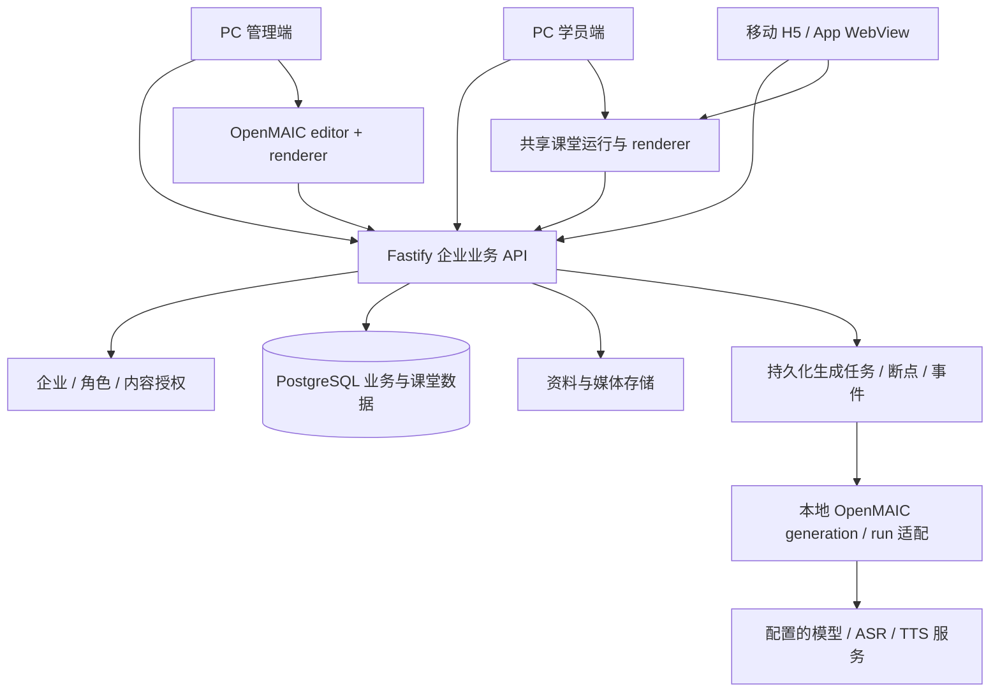

# 鲸智智训三端与 OpenMAIC 集成实施计划

> 本轮状态：按用户延期真实模型测试与App集成后的范围，PC管理端/PC/H5本地业务闭环验收完成。逐项证据见IMPLEMENTATION_STATUS.md首节；生产部署和M4扩展仍为后续工作，不能据此宣称全产品上线完成。

> 最新范围决定：用户明确模型配置及真实模型页面测试延期，由用户后续完成；App集成也延期。当前验收聚焦PC管理端、PC学员端、H5业务闭环。下文历史“等待模型配置”的阻塞描述不再作为当前完成门槛；真实AI结果仍必须标记待实测。

> 当前范围更新：用户已明确“先不要管App，后期使用H5集成”。本轮完成条件仅覆盖PC管理端、PC学员端和H5；原生App/WebView实测延期，不再阻止本轮闭环验收。以下历史章节中的App要求保留为后期事项。

更新时间：2026-10-15。本文记录代码审核结论、实施顺序和可验收结果；“已有基础”不等同于上线完成。当前先完成企业试用闭环，再扩展完整学、训、考能力。

## 1. 审核结论

方案可行。保留现有 Fastify / TypeScript / PostgreSQL 业务后端，以及 `admin`、`learner`、`frontend` 三个 React / Vite 应用；把 OpenMAIC 的源码包和服务能力接入同一业务体系。App 首期嵌入现有移动 H5，使用同一套账号、权限和学习数据，不另建原生学习页面。

初始审核时，移动 H5 还是演示，OpenMAIC 只有签名桥接。下表保留初始差距作为实施基线，并非当前能力清单。当前已实现三端真实业务、共享课堂编辑/播放、资料解析、本地生成任务和报告；后续章节记录验证证据。真实供应商制课、实际原生 App 和生产部署仍未通过完整验收，不能宣称整体完成。当前任务的完成条件是第 7 节的实际闭环验收全部通过。

| 模块 | 已有代码能力 | 必须补齐的部分 |
| --- | --- | --- |
| 企业与账号 | 会话、CSRF、多企业成员资格、角色校验、禁用账号和企业切换 | 三端一致的登录/退出、邀请或开通流程、改密 UI、租户切换清理本地缓存 |
| 管理端课程与任务 | 课程 CRUD、不可变发布版本、指定成员任务、顺序解锁、审计 | MAIC 课堂编辑、内容可见范围、生成任务审阅、知识文件解析状态 |
| 知识文件 | 文件落盘、大小与基础格式校验、企业隔离；TXT/MD 提取 | PDF/DOCX/PPTX 解析、失败重试、引用与页码、扫描件 OCR 扩展、删除/归档引用策略 |
| OpenMAIC 桥接 | 服务端企业签名、启动幂等、状态查询、大纲确认接口 | 当前发送 `materialIds: []`；没有自动资料映射和结果回写，不能构成制课闭环 |
| 模型配置 | 本次新增企业级配置、AES-GCM 密钥加密、真实连接测试入口 | 本地生成管线实际消费配置、能力选择、额度/用量/故障处理；供应商待管理员填写 |
| PC 学员端 | 真实课程、任务、文本/视频学习、进度、考试、收藏、评价、消息、检索会话 | MAIC 场景播放、课内练习与运行态、AI 对练、语音与完整权限过滤 |
| H5 / App | 移动版完整视觉与模拟交互 | 去除 mock 与虚拟分数；接入共享 SDK、会话、进度、考试和训练；App 宿主协议 |
| 考试 | 服务端计时与客观评分、试卷快照、提交幂等、主观题人工复核接口 | 题库 UI、组卷和人工阅卷 UI、AI 建议与正式分数隔离、答案并发覆盖保护 |
| 训练 | 会话、消息、提交与人工评价真实入库 | 模型角色对练、自动评价和依据、ASR/TTS、评分版本；ASR 识别不等于发音评分 |
| 报告 | 任务完成汇总和审计、考试/训练明细 API | 按成员/课程版本的明细、未完成原因、导出、部门聚合与指标口径 |
| UI | 三端基本遵循品牌蓝与浅色底 | 本次共享令牌落地；仍须逐页审核，尤其 H5 接 API 后的五类状态 |
| 运行部署 | 本地持久化 PGlite；已有 PostgreSQL 和容器配置 | 本机缺少 Docker/PostgreSQL 实机验收；迁移、备份恢复、HTTPS、并发与重启测试 |

主要证据：[source:backend/src/integration.ts] [source:backend/src/learning.ts] [source:backend/src/portal.ts] [source:backend/src/admin.ts] [source:frontend/src/mock.ts] [source:frontend/src/App.tsx] [source:learner/src/workflows.tsx]。

## 2. 集成边界与迭代方式

业务后端是企业账号、成员范围、发布版本、任务、进度、正式考试成绩的唯一权威。OpenMAIC 负责课堂文档、生成、交互和渲染；不得从浏览器直接访问其他企业的原始文档或模型密钥。课堂练习成绩与正式考试成绩分别存储。

| OpenMAIC 能力 | 接入方式 | 关键约束 |
| --- | --- | --- |
| `@openmaic/dsl` | 本地 workspace 包引用，统一课堂文档契约 | 校验与迁移版本明确，不能用任意 JSON 冒充合法课件 |
| `@openmaic/generation` | Fastify 的模型适配器实现 `AICallFn` | 保留上游提示词、JSON 修复和生成逻辑；正确打包 Markdown 提示词资源 |
| 服务端 generation/run | 抽取宿主服务接口，适配业务 DB、模型、材料与资源 | 现有引擎有 Next `@/` 依赖，不能直接复制 import 后视为接入；保留租约、检查点与事件语义 |
| `@openmaic/editor` | 管理端受控编辑器，宿主保存文档、撤销状态、资源 | 不把编辑器的本地存储作为课程权威数据 |
| `@openmaic/renderer` | 管理端预览与学员端共用渲染 | 依赖 Tailwind 4 样式扫描、字体和 KaTeX；隔离 preflight，避免冲掉现有 UI |
| `@openmaic/storage` | 通过现有 PostgreSQL 驱动适配文档、资产与运行态 | 包本身不是企业权限系统；所有查询都需企业/成员/课程版本上下文 |
| `@openmaic/importer` | 管理端浏览器 PPTX/PDF 导入，资产经后端授权上传 | 有 DOM/Canvas 依赖，不能直接在 Fastify Node 运行 |
| 课堂运行组件 | 抽取播放器、动作与运行态接口，适配三端 | 只接 SlideCanvas 不是完整互动课堂；处理 Next 路由、主题、媒体、store、session 依赖 |
| PBL / 多角色 / Widget | 闭环稳定后接入共享运行层 | Widget 运行沙箱；限制文件、网络和宿主能力；PBL 需要会话私有性和恢复 |
| ASR / TTS / 图片视频 | 服务端能力适配与资源引用 | 分开配置模型能力；缺少能力时明确禁用，不伪装成成功 |

源码证据：[source:OpenMAIC/packages/@openmaic/generation/src/outline-generator.ts] [source:OpenMAIC/packages/@openmaic/generation/src/prompts/loader.ts] [source:OpenMAIC/lib/server/generation/run/engine.ts] [source:OpenMAIC/components/classroom/ClassroomSurface.tsx]。

上游维护策略：建立根 workspace 和单一锁文件，引用本地源码包，记录当前 OpenMAIC 提交 `ecb940c136cc5b4ea56dc81b2505e64eff1dea29`、包版本及适配补丁。升级先生成差异、执行 DSL 迁移和契约回归，再升级当前项目。保留仓库现有未提交改动，不自动覆盖头像及脚本。禁止跨版本静默修改已发布课堂文档。

## 3. 数据和接口补齐

1. **课堂文档**：draft 可编辑、revision 乐观锁；发布时保存完整不可变课堂和资源引用，课程版本关联文档版本。历史任务始终指向原版本。
2. **资料处理**：文档表保留原件、解析版本、页/段落、状态和错误；解析任务与生成任务分离。未解析成功不得作为已理解的制课材料。
3. **制课任务**：企业、操作者、目标草稿、材料快照、需求、模型标识、幂等键、检查点、大纲修订、事件和失败原因。状态至少包含排队、生成大纲、待审阅、生成场景、待审核、失败/暂停、取消、完成。重启不重复完成的步骤或自动重复扣费。
4. **内容范围**：企业全部成员 / 部门 / 指定成员；内容列表、详情、文件下载、检索与助手引用执行同一授权规则。任务分配限定在可访问成员，归档和时间边界明确定义。
5. **学习记录**：成员 + 课程版本 + 场景/章节；服务端事件幂等，支持续学和跨设备同步。课堂互动运行态按成员私有保存，禁止其他成员读写。
6. **任务报告**：接收人、冻结课程版本、每阶段完成状态、最后学习时间、截止与逾期、成绩与人工复核状态。完成度由实际数据计算，不能由前端传百分比覆盖。
7. **模型安全**：企业独立密钥、服务端出站请求、有界超时/响应、无秘密回显。新增配置迁移为 `003_ai_provider.sql`，后续迁移递增，不改写已应用迁移。

共享 SDK 统一 cookie、CSRF、企业切换、重试和错误码；进度/作答/聊天写入都需幂等语义。App 嵌入协议须版本化，覆盖 ready、登录授权交换、返回、文件打开、录音权限和页面恢复；禁止通过 URL 传长期令牌。账号密码不交给宿主页面脚本。

## 4. UI 审核与修复计划

视觉方向沿用 [source:frontend/STYLE-GUIDE.md] 的“效率优先”：品牌蓝 `#246bfe`、浅灰蓝画布、白色内容面。PC 管理端用于配置与审核，PC 学员端用于学习，H5 保留五栏导航，三端布局可以不同，但语义、颜色、字号、控件状态和业务文案一致。

| 审核项 | 发现 | 处理 |
| --- | --- | --- |
| 设计令牌 | 各端复制 `:root`，学员端成功色不同、字体顺序不一致 | 本次新增 `shared/design-tokens.css` 并让三端引入，统一兼容变量 |
| 次要文字 | 原 `#8b97a8` 白底约 2.96:1，不适合小正文 | 本次把共享低强调文字改为 `#63738a`；后续清理仍硬编码的浅灰文字 |
| 品牌标识 | PC 以帽子图标、移动端鲸品牌表达存在差异 | 确认一套本地品牌标识和头像/封面占位，三端引用共享资源 |
| 管理表单 | 制课目前只有桥接状态，缺少完整审阅流程 | 已增加模型配置；继续补资料选择、进度、失败恢复、大纲及课件审阅 |
| 学习/考训状态 | PC 有真实记录，H5 用模拟计时、分数和回答 | H5 接入同一 API；缺少模型时显示待配置/待评价，禁止成功式占位 |
| 五类状态 | 需按页面逐一验证，不能仅看首页 | 默认、加载、完成、空结果、异常；保存中禁用、防重复、失败保留输入 |
| 设备布局 | PC 不能直接放大移动页面；H5 需安全区 | PC 1440/1280/1024，H5 390/360、横屏课堂、长标题、键盘弹起、底部操作 |
| 无障碍 | 必须保留焦点、标签、键盘路径 | 本次共享 focus-visible 和减少动画设置；继续检查弹窗焦点与文本对比度 |

新增页面视觉约束：主工作区承载实际操作，次要信息放目录或检查面板；避免在管理页面加营销大图和装饰卡片。编辑器样式限定容器，课堂字体和媒体布局不污染主站。

## 5. 分阶段开发与依赖

### M0 · 基线、配置与共享规范（进行中）

- [x] 确认各端真实/模拟边界和 OpenMAIC 依赖边界。
- [x] 企业模型配置 API / UI、加密、连接测试、权限与企业隔离测试。
- [x] 三端共享设计令牌与基础焦点/减少动画规则。
- [x] 根 workspace、单一锁文件、上游版本基线、统一构建入口；生成字体产物差异已记录。
- [x] 共享学员 SDK、基础错误处理与企业/成员上下文隔离；重新登录同身份可恢复CSRF，身份变化拒绝旧请求。

出口：管理员可保存自己的模型配置；基础构建和契约回归可重复执行。

### M1 · 资料 → AI 大纲 → 课程草稿

- [x] TXT/MD/PDF/DOCX/PPTX 正文提取、解析接口、错误与重试；扫描件明确需 OCR。图片/版式解析后续扩展。
- [x] 本地引用 generation / DSL，模型适配器使用本企业配置，材料以授权快照传入。
- [x] 持久化生成任务、幂等、事件、场景检查点与内容检查点、显式重试；租约限制并发与重复请求。
- [x] 管理端选择资料、描述目标、查看任务、编辑确认大纲、生成场景；真实供应商交互验收待配置。
- [ ] 真实供应商制课记录：输入文件、任务 ID、模型、输出、失败恢复证据。

依赖 M0。出口：实际上传的资料影响生成内容，结果是合法课堂草稿；不能自动发布。

### M2 · 编辑 → 发布 → 分配 → PC 学习 → 报告

- [x] editor 受控集成、保存冲突、撤销、renderer 预览。
- [x] 编辑器图片/音频/短视频上传、课程素材库复用、发布引用冻结与鉴权；真实视频播放和实际App权限仍待验收。
- [x] 课堂发布快照、内容范围、指定学员任务和历史版本保护。
- [x] PC 场景播放、目录、讲解/课内答题/反思进度与恢复。
- [ ] Widget内部状态、完整多角色和实时PBL运行态。
- [x] 管理端任务成员明细和课程完成情况，区分未完成、待评和完成。

依赖 M1。出口：企业管理员→指定 PC 学员→管理员报告完成一次真实闭环。

### M3 · H5 / App 共用真实业务

- [x] 保留移动导航与视觉，替换 mock 为共享 SDK，加入登录和企业上下文。
- [x] 课程、任务、学习进度、考试、训练记录、知识检索、个人记录与 PC 使用同一后端；AI对练和生成式助手仍属M4。
- [x] 复用课堂运行层、移动布局和触摸，H5考试后台/离页触发答案保存、并发答卷保护。
- [ ] 实际App视频/音频权限和后台恢复验证。
- [x] 交付App宿主协议v1、消息示例及输入校验单元测试。
- [ ] 外部App宿主完成WebView实测。

与 M2 共享 SDK 工作可以提前，最终验收依赖 M2。出口：同一账号 PC→H5→App 的进度可恢复和对账。没有宿主实测只能标记 H5 完成、App 待验收。

### M4 · 完整学、训、考能力

- [x] 客观题服务端评分、管理员阅卷队列、主观题人工确认；考试保存/提交修订冲突保护。
- [x] 按考试课程维护题库UI，题目启停、答案/解析/分值及固定100分试卷发布。
- [ ] 高级组卷、批量导入与主观题AI建议。
- [ ] 角色 AI 对练、流式对话、评价维度/证据、评分版本、复盘和重练。
- [ ] ASR/TTS 和录音授权；发音评分需独立能力验证。
- [ ] 多角色课堂、课内测验、PBL、Widget；沙箱和运行态恢复。
- [ ] 助手知识应用范围、检索索引、引用来源、内容权限和无依据回答控制。
- [x] 任务成员学习明细CSV导出，含冻结版本、课时完成、待评/分数和最后活动，部门管理员范围过滤。
- [ ] 跨任务部门/成员汇总报告、基础额度用量管理。

出口：完整学习训练考试功能逐项验收，模型缺失或低置信度能真实失败/转人工。

### M5 · 企业试用与上线验收

- [x] 本地PGlite数据库、知识原件和课程素材备份及隔离恢复演练。
- [ ] 外部 PostgreSQL 迁移、Docker 构建、HTTPS 反代、生产数据库及文件恢复。
- [ ] 多企业与多角色权限矩阵，文件/版本/检索/运行态越权测试。
- [ ] 后台任务重启、并发写入、重复提交、断网恢复、超时与取消测试。
- [ ] 三端关键流程截图、浏览器/App 兼容、键盘与对比度审核。
- [ ] 企业试用账号和操作手册、运行监控、失败任务排查及升级回滚步骤。

出口：第 7 节通过，补齐可重复操作的验收证据后才认定可用。

## 6. 本次已经实施及验证

- 已新增模型配置模块，入口为管理端左侧“AI 课堂能力”。企业管理员可保存配置并主动测试真实模型接口；目前未填真实供应商，未执行真实 AI 制课。
- 新增迁移 003；本地服务已重启加载迁移，旧课程与任务保留。
- 后端自动化 14 项通过，其中模型用本地 HTTP 测试服务验证真实网络适配、企业隔离、密钥加密/不回显、保留及解密失败处理。
- 三端令牌收敛；后端和三端生产构建通过。H5 原依赖安装不完整，已通过锁文件重新安装并构建成功；这不代表 H5 已接入业务后端。
- 管理端 6 项领域测试、PC 学员端 3 项领域测试通过；结合后端共 23 项自动化通过。
- 配置界面截图：[source:admin/evidence/ai-provider-configuration.png]。模型配置说明：[source:backend/AI_CONFIGURATION.md]。

上述测试不覆盖生产 PostgreSQL、完整 OpenMAIC Next 构建、真实生成、移动后端联调及外部 App 宿主。

## 7. 完成条件与验收脚本

1. 企业 A 管理员上传一份真实资料，解析成功；企业 B 和未授权学员不能下载或检索。
2. 管理员通过已配置的真实模型生成大纲，修改大纲，生成并编辑课堂内容；保存、刷新和重启后草稿可恢复。
3. 发布 v1 给指定成员，非接收者按可见范围被拒绝；管理员修改 v2 不影响 v1 任务、试卷和进度。
4. 指定学员登录 PC 打开任务并学习，服务端存储真实章节/场景进度；刷新与重新登录后恢复。
5. 同一学员从 H5 继续并完成余下学习；PC/H5之间正确恢复已保存状态，跨端冲突不静默覆盖，重复事件不重复累计。实际App宿主集成按用户最新要求延期。
6. 管理员看到该成员各课程版本的完成状态、最后活动与任务完成结果，和数据库记录一致。
7. 断网、模型失败、重复点击、超时、后台重启、草稿修订冲突均有可恢复状态，无自动伪造结果或重复发布。
8. UI 五类状态、PC 与移动断点、资源缺失、焦点、长内容、安全区通过，三端品牌与状态语义一致。

当前不满足 2、5 及完整 6/7/8，闭环目标仍在进行中。

## 8. 2026-10-15 后续实施进展

根工作区、锁文件与构建入口已落地；直接接入本地 DSL/generation，资料解析、制课任务、大纲修订、场景与动作检查点、草稿应用及课堂发布快照已实现。后端18项、管理端6项、PC学员端3项共27项自动化通过；本地测试模型驱动整个后端制课链路。根 pnpm build 通过四个上游包、后端及三端构建。生产 deploy 目录验证提示词资源可加载，但 Docker 与外部 PostgreSQL仍未实机验证。

课件可视化编辑器、学员播放器、完整内容ACL、H5真实API、App宿主与报告明细仍待实现。真实云模型配置未填，本轮没有在真实业务库生成任何模拟课件。目标仍未完成。新增模块说明见 backend/AUTHORING.md 和 WORKSPACE.md。

## 9. 课堂编辑与PC报告实施进展

本地编辑器与renderer已接入，包含画布编辑、预览、场景顺序、课内练习、互动隔离及项目反思；运行记录按成员/课程版本/场景存储，支持幂等和冲突检测。管理端成员任务报告已实现。浏览器真实完成手工QA课件编辑发布v2、播放和记录恢复、原v1任务学习及管理端3/3完成报告；见 CLASSROOM_QA.md。共享UI新增3项安全测试，合计30项。H5/App、完整内容ACL与真实云模型验收仍待完成。

## 10. 最新验收与剩余工作（覆盖历史状态）

2026-10-15：管理端、PC与H5均接同一后端和本地OpenMAIC包。PC→H5手工QA课程完成、冻结版本保护、管理报告、考试保存/恢复/100分、训练提交→人工评价→H5回写均有浏览器证据。内容ACL覆盖企业/部门/成员、文件和助手历史引用。原型与真实AI输出明确区分。

新增migration007、共享答案写入器和会话传输层。PC与H5对同一答卷双向制造冲突，旧写入被拒绝；主动重新加载后保留另一端答案，最终100分提交。H5重新登录同一账号后，PC不用刷新即可恢复CSRF并成功保存；不同账号/企业不重放旧操作。

统一 `pnpm test` 47项通过（后端22/管理6/PC3/课堂UI3/H5与共享SDK13），后端/PC/H5最新构建通过。详见 CLASSROOM_QA.md、IMPLEMENTATION_STATUS.md。

完成条件逐项判断：1 资料解析与ACL已验证；2 真实供应商未配置，仍缺真实AI生成证据；3/4/6 手工课件的发布、版本、学习及报告已验证，仍需与真实生成产物串联；5 PC/H5已验证，实际App未验证；7 已覆盖多数接口故障/幂等/冲突，生产与实际App断网恢复未完整覆盖；8 三端共用视觉与移动断点已有截图，实际App和全页面可访问性待补。完整目标仍在进行，不能将通过局部检查等同于完成。

## 11. 文件管理入口的实际补齐

知识范围组件此前未挂载，已在本轮实际接入文件详情；加入解析/重试/预览、范围并发检查、租约超时恢复。浏览器已验证手工Word上传到指定学员检索下载、撤销后历史引用与旧链接失效、恢复授权，以及PC共享会话。后端23项、累计48项通过；详见CLASSROOM_QA.md。真实AI供应商、外部App和生产环境仍未验收，不更改其完成条件。

## 12. 下载失败状态与宿主协议补齐

PC/H5资料下载已改为页面内处理权限/网络错误与重试，浏览器实际验证撤权失败和恢复后成功，原件hash一致。App v1增加显式声明的下载能力、HEAD授权预检、受限资料路径和真实保存结果回传；宿主实现要求与示例见frontend/APP_EMBEDDING.md。相关41项测试通过，累计53项；PC/H5构建通过。实际App文件保存、登录Cookie同步等仍未验收，不勾选外部App完成条件。

## 13. 课程素材接入与跨端验证

2026-10-15：新增迁移008和企业课程素材存储，OpenMAIC编辑器通过宿主asset picker上传/复用图片、音频及短视频；管理预览与学员播放使用不同鉴权入口。发布时冻结素材引用，学员只能读取有权访问的发布版本；替换新版本素材不破坏旧任务。上传期间禁用编辑与发布，保持三端蓝白视觉规范。

浏览器实际发布手工课件“课程素材验收（手工测试课件）”v1，课程ID fd7b8d35-9df3-4a64-b0ea-9bf8524d3f50，插入实际WebP与1秒测试提示音。PC/H5加载图片并启动音频播放；PC完成1/1课时，H5刷新目录显示完成，任务“课程素材学习验收任务”报告显示林雨欣已完成v1、1/1课时。该课程明确不是AI输出。

统一pnpm test共55项通过（后端24/管理6/PC3/课堂UI3/H5与SDK19），后端及三端生产构建通过。自动化覆盖跨企业/角色拒绝、伪造格式拒绝、草稿隐藏、发布版本引用、范围撤销、跨课程引用拒绝和Range读取。真实视频播放、实际App、云模型生成及生产恢复仍待验证，完整目标继续进行。

## 14. 本地数据库和原件恢复演练

已新增排他数据锁与本地backup/verify/restore/audit工具，包含文件hash清单和空目录，目标不覆盖。实际停止服务后备份1135文件并恢复到隔离目录，数据库打开成功；业务接口登录后读到素材课程v1、林雨欣1/1进度和任务完成报告，Word/图片hash一致。原服务已恢复。详见backend/LOCAL_BACKUP.md。

新增备份测试覆盖损坏拒绝、旧目标保护、加密密钥文件保留等；后端25项通过，加未变更的其他31项累计56项。生产PostgreSQL/Docker与外部App、真实云模型仍未验收；本地恢复完成不替代它们，目标继续进行。

## 15. 课堂媒体异常与UI完善

已补齐共用播放器的中文音频按钮、播放许可与资源错误、图片/音频/视频原页重试、卸载停止播放。PC/H5实际验证手工素材文件缺失→提示→恢复→原页重试成功；进度保持1/1，最终素材已恢复。共享课堂UI8项通过（新增5项），结合未变更模块累计61项；renderer及三端构建通过。上游音频slot小范围扩展与升级契约说明见WORKSPACE.md，浏览器证据见CLASSROOM_QA.md。

继续保留真实云模型生成、实际App和生产部署未完成条件；未将媒体单测外推为实际App/真实视频兼容通过。

## 16. 制课失败不伪装成功与重启恢复

审查发现上游讲解动作生成遇到无效模型文本会回退为大纲拼接讲解；Fastify现做严格检查并暂停，不把该回退当成生成完成。保留pendingContent，重试只补生成讲解；自动化覆盖无效动作→暂停→禁止应用→重试→完整发布学习报告。新增真实关库重开后的过期租约恢复测试，保留检查点、清空租约、修订仅增加一次并可取消。

后端26项通过、生产构建通过；结合未变更模块累计62项。详情backend/AUTHORING.md。真实供应商/实际App/生产环境仍未验收，目标继续进行。

## 17. 学习明细报告导出

原导出仅任务汇总，现明确更名并增加所选任务成员/课程版本明细。服务端取完整授权范围、共享分页报告口径、一致快照与CSV转义，超过导出限制明确失败。实际浏览器下载并读取CSV验证素材课程v1、林雨欣1/1及任务完成，与页面一致。

后端27项通过、后端和管理端构建通过；结合未变更模块累计63项。未将此项扩大为跨任务运营报表或额度系统完成。真实云模型、实际App和生产验收继续保留未完成。

## 18. 课堂未保存内容恢复

新增SceneWriter：不确定网络失败保留同一事件和快照重试，串行修订、排队最新内容、冲突/权限停止；共用会话UI增加保留当前内容重试、重新加载前提示、反思复制。未同步禁用完成课时/目录切换，后台和离页尝试提交防抖队列。

PC实际断开服务→保存失败保留2/3→恢复原页重试→H5恢复2/3；再验证PC新3/3记录拒绝H5旧写入、主动重载恢复3/3。共享UI12项通过、PC/H5构建通过，累计67项。详见CLASSROOM_QA.md。

仍需统一浏览器历史/全局导航/App宿主离开保护及实际后台强杀恢复验证；未实现持久离线库。真实云模型/App/生产环境未完成条件保持。

## 19. 课堂离开检查与App取消协议

已把课堂未保存守卫接到PC/H5全局路由、返回、退出及企业切换；取消原始hash变化时在卸载前恢复页面，已确认导航不重复提示。App取消返回/导航回传ok=false且不请求宿主关闭，navigation消息读取守卫处理后的最终地址，协议说明已更新。

共享UI14项、H5/SDK21项通过，PC/H5构建通过，结合其他模块累计71项。浏览器实际验证已保存状态正常进入任务页。取消保护与App通知顺序是受控测试证据，实际WebView返回栈/强杀仍待实机；浏览器取消历史返回会重写条目，保留这一限制。课堂guard不等于所有考试/训练表单已有同等保护。

真实供应商制课、实际App和生产部署验收未改变，目标继续。

## 20. 考试/训练离开与训练草稿结束

PC/H5考试脏答案和训练草稿接入共用离开检查，考试计时继续明确提示。训练结束现可原子保存当前未单独发送的表达并转待评价，重复操作不多存消息，错误回滚；保存期间禁用输入/角色切换。

浏览器实际H5未先保存表达直接结束→H5复盘→PC复盘→管理员原文查看通过，没有伪造评分。后端28、UI15项及后端/PC/H5构建通过，累计73项。独立PC结束按钮、原生App取消、系统强杀与真实AI仍需验收；未将共享代码当成全部实测完成。

## 21. 既有自主考试/训练跨发布版本与PC提交验收

修复直接复盘时课程标题依赖旧概览缓存；服务端提供该记录对应的冻结课程元数据。进一步修复自主考试/训练在课程发布新版后无法访问原记录的问题：只保留本人已创建记录的原版本，继续验证当前ACL，不开放任意旧版本新建/正文。

新增/扩充HTTP集成验证原答卷保存提交、原训练继续结束、元数据/评分不变及撤权/他人拒绝。PC独立草稿随结束保存→PC/H5复盘→管理员查看通过，未评分。后端29项和相关构建通过，累计74项。真实云模型、实际App和生产环境仍未验收，目标继续。

## 22. 管理端题库与固定试卷发布

已接五种题型维护、启用/停用、答案与解析；发布冻结启用题，非空合计100，失败回滚，旧答卷不变。编辑中保护发布/关闭，额外核对课程更新时间，保持既有蓝白风格。

实际管理员创建手工单选试卷→停用发布拒绝→恢复发布v1→PC作答100分→H5同答卷成绩通过。后端30项及后端/管理端构建通过，累计75项。高级组卷/AI建议仍未完成；开发热更新CSRF恢复问题留待修复。真实模型/App/生产环境条件不变。

## 23. 管理端会话恢复与企业上下文（2026-10-15）
- 已完成：管理端请求携带账号/企业/成员上下文，复用服务端认证钩子；明确 CSRF_REFUSED 后才取回当前身份，同一身份只重试一次。
- 保留原请求体、If-Match、幂等键、FormData，不重放网络异常、5xx、权限拒绝、版本冲突。恢复期间发生本地会话更新会终止旧操作，不覆盖新会话。
- 没有已确认身份的页面拒绝业务请求并提示刷新；旧版开发热更新首次接入需要刷新测试页。用户填写中的模型配置页未强制刷新。
- 验证：管理端19项测试和生产构建；后端31项测试（包括真实认证钩子+临时PGlite的恢复/切企业拒绝）。本轮未浏览器人为轮换真实登录 cookie；不声称浏览器故障复现已覆盖。
- 未完成：真实供应商制课、外部原生App、生产部署验收；目标保持进行中。

## 24. H5交卷弹窗键盘与窄屏验收（2026-10-15）
- 原自绘遮罩没有焦点管理。改为HTML原生模态dialog，使背景不可交互；显式处理Tab/Shift+Tab循环、Escape取消、关闭后恢复触发按钮焦点、页面滚动锁。
- 真实浏览器390×844：初始焦点“继续作答”；双向循环保持弹窗内；Escape/继续作答保留A答案且恢复“提交试卷”焦点；确认交卷得到服务端100分。
- 手工试卷 b5560113-9bd9-4f4e-b889-28f11925fd99，新增第二次测试答卷 d000f21a-30d1-4fa6-bff4-f9e9d9df1c6e（不冒充AI生成）。未变更正式试卷或配置。
- H5生产构建通过。截图 frontend/evidence/exam-confirmation-390.jpg、exam-confirmation-result-390.jpg。测试后恢复浏览器默认viewport。
- 仅桌面浏览器窄屏及键盘证据；旧版WebView对showModal、inert及动态视口的支持和实际App返回行为仍需宿主实测。完整三端无障碍检查尚未完成。

## 25. 制课大纲未保存保护
代码审核发现审阅大纲时切换任务、关闭AI课堂服务窗口会直接丢弃编辑。本次补充未保存提示：切换/重载任务、取消任务、关闭窗口需确认放弃；浏览器刷新/关闭使用beforeunload保护。任务加载失败时仍保留原大纲和选中任务，保存成功后才清理dirty标记。
同时为加载增加请求序号，操作开始使旧轮询失效；操作期间暂停定时轮询，以免旧结果覆盖新任务/保存结果；互斥标记阻止同一帧重复操作。只影响管理端，后端任务状态机和发布语义不变。
验证：管理端TypeScript及生产构建通过（.deploy/authoring-draft-guard-build.log，已有chunk体积提示仍在）。本轮未配置模型或生成新的真实大纲，未声称已通过真实大纲浏览器交互验收；以上离开确认和网络竞态仍需在可用制课任务中验证。原模型配置页未刷新，输入保留。

真实供应商制课、实际App和生产部署仍待验收；不据此关闭完整目标。

## 26. 企业试用操作指引
管理端“使用指南”已按现有按钮与流程扩展为8步，覆盖账号、解析、模型验证、大纲审核、草稿编辑发布、指定成员任务、跨端保存、报告核验，并提供失败恢复及考训能力说明。修正backend/README.md过时npm ci与PDF/Office未解析描述，统一根pnpm工作区。管理Modal焦点列表补入链接及summary，避免新折叠项逃出焦点循环。
验证：管理端构建通过（.deploy/usage-guide-build.log）；真实浏览器展开故障处理说明、截图admin/evidence/usage-guide.jpg；完整重载测试页后，末尾summary按Tab回到关闭按钮，关闭按钮Shift+Tab回到末尾summary。热更新前旧事件闭包未反映新选择器，已通过重载测试页复验；用户原模型配置页未刷新。未运行实际云模型、原生App或生产部署；操作指引不等同于这些验收已完成。

## 27. 工作区回归与范围更新
- 根目录 `pnpm test` 成功退出：backend31、admin19、PC3、classroom-ui15、H5/SDK21，共89项通过、0失败。日志 `.deploy/workspace-regression-latest.log`。这次真实重跑所有五个工作区测试入口，不是相加历史结果。
- 用户明确App延期，本轮不再等待原生宿主。保留已实现的协议和H5能力，后期再进行WebView集成及设备验收。
- 当前仍需要真实模型完成资料生成→人工编辑→指定成员任务→PC/H5续学→报告的同一条证据链。手工课程浏览器证据和本地测试模型不能替代真实供应商。
- 当前PATH中未发现docker/psql；生产环境验收仍未完成，但不把工具不存在推断为所有外部环境均不可用。
