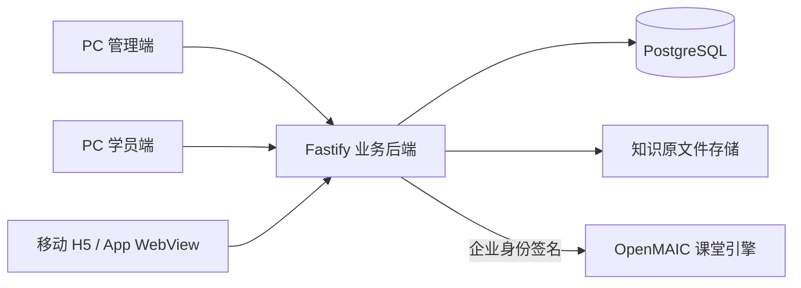

> 当前依赖统一在仓库根目录通过 pnpm 安装与构建，见 [工作区说明](../WORKSPACE.md)。本地 OpenMAIC 源码制课见 [AUTHORING.md](AUTHORING.md)；下文桥接章节保留为独立服务兼容说明。

# 企业培训业务后端

## 技术选择

OpenMAIC 的服务端位于 Next.js Route Handlers，使用 Node.js / TypeScript、PostgreSQL，并包含 PGlite 开发依赖。本项目采用 **Node.js 22.19+ / TypeScript / Fastify 5 / PostgreSQL / Zod** 构建独立业务 API，保留 OpenMAIC 的生成引擎。业务账号、企业隔离和课程版本由本后端维护，AI 引擎不直接管理培训业务表。

本地未配置 DATABASE_URL 时采用磁盘 PGlite，SQL、事务及数据模型与 PostgreSQL 共用；生产环境强制使用外部 PostgreSQL。PGlite 只允许一个后端进程访问同一数据目录，不能作为多实例生产数据库。



## 本地启动

在仓库根目录运行，统一使用根工作区依赖：

```powershell
pnpm install --frozen-lockfile
pnpm build:maic
pnpm --filter ola-training-backend build
pnpm --filter ola-training-backend start
```

其他终端分别运行 `pnpm --filter ola-training-admin dev`、`pnpm --filter ola-training-learner dev` 和 `pnpm --filter ola-training dev`。管理端为 http://127.0.0.1:4180，PC学员端4181，H5为4173，各端 `/api` 代理到后端4190。需配置环境时参考 `backend/.env.example`，保留已有本地配置；不要重复启动后端访问同一PGlite目录。开发热重启使用 `pnpm --filter ola-training-backend dev` 替代 start。详见 [工作区说明](../WORKSPACE.md)。

首次开发启动创建两个示例企业；邮箱 `admin@ola.local`，随机密码写入 `backend/data/bootstrap-credentials.txt`，只生成一次。账号密码由 scrypt 加盐散列存储。正式环境首次启动必须设置 BOOTSTRAP_ADMIN_PASSWORD（至少 12 位），不生成演示内容。环境变量详见 `.env.example`。

## 已实现的数据与规则

- 企业、部门、账号、成员及企业角色；平台管理员创建企业；成员开通登录账号、停用与会话撤销。
- HttpOnly Cookie 会话、CSRF、写请求 Origin 校验、登录限流。邮箱全局唯一，账号可持有多个企业成员身份；切换企业必须有有效成员关系。
- 课程草稿、发布、归档、恢复；每次发布保存完整内容快照。已分配任务固定课程版本和成员名单，后续改课不影响旧任务。
- 知识文件上传、原文件下载、SHA256 元数据和归档；单文件 10MB。TXT/Markdown 提取 UTF-8 文本；PDF文本层、DOCX/PPTX 可通过解析接口提取正文，保留原件和失败状态。扫描件 OCR 和向量检索未接入。
- 考试题目、试卷快照、服务端计时、次数限制、答案保存、客观题评分和主观题人工阅卷；客户端无法上报自定成绩。
- 学员自己的任务、课程版本、学习进度；顺序任务前置校验和幂等完成记录。
- 训练会话、学员消息、提交及管理员人工评价；AI 对练、语音识别及自动评分尚未接入。
- 企业维度统计、审计记录、可选 If-Match 并发版本校验、跨企业复合外键。

租户隔离采用共享数据库、租户字段、会话校验、查询约束和复合外键；目前没有数据库 RLS 或独立企业数据库。企业管理员维护成员和任务；内容作者维护课程、题目和知识；部门管理员的初始化视图限本部门，暂不提供部门级编辑接口。管理端部分按钮仍对较低权限角色显示，服务端会拒绝越权操作。

## API 约定

PC 学员端已在 `learner/` 实现并接入。新增 `/api/learn/overview`、收藏、评分评论、通知已读、学习排行、关联资料下载和助手检索会话，详见 [PC 学员端说明](../learner/README.md)。助手为关键词原文检索，没有连接大模型。学员端认证请求传 `X-Ola-Client: learner`，使用独立 Cookie `ola_learner_session`；管理端保持 `ola_session`。开发允许 LEARNER_ORIGIN（默认 http://127.0.0.1:4181），生产设置 HTTPS 学员域名。学习资源下载自动选择学员 Cookie。

登录 `POST /api/auth/login`：`{"email":"...","password":"..."}`。后续请求携带 Cookie；`GET /api/auth/me` 返回用户、可访问企业和 csrf；所有认证写接口传 `X-CSRF-Token`。浏览器同源调用，跨源访问未开放。非浏览器客户端需保存 Cookie，并同样传 CSRF。

`GET /api/bootstrap` 返回当前管理视图及 revision。管理写接口可传 `If-Match: <revision>`，过期返回 409，重新读取再编辑。企业 URL 的 tenantId 必须与会话当前企业一致；先调用切换接口才能访问另一企业。

| 接口 | 作用 |
| --- | --- |
| GET `/api/health` | 数据库健康检查 |
| GET `/api/auth/me`；POST `/api/auth/logout`、`switch-tenant`、`password` | 会话、退出、切换企业、改密（改密后全部会话失效） |
| POST `/api/platform/tenants` | 平台开通企业 |
| GET/POST `/api/tenants/:tenantId/courses`；GET/PUT `courses/:id` | 课程列表、创建、读取、更新 |
| GET `courses/:id/versions`；POST `courses/:id/archive`、`restore` | 完整历史版本与归档恢复 |
| GET/POST `tasks`；PUT `tasks/:id`；POST `tasks/:id/archive` | 任务草稿、发布与归档 |
| GET/POST `members`；PUT `members/:id`；POST `members/:id/account` | 成员、启停与开通登录 |
| PUT `settings`；GET `reports` | 企业设置、统计与审计 |
| GET/POST `knowledge`；GET `knowledge/:id/download`；POST `knowledge/:id/archive`、`restore` | multipart 文件上传及管理 |
| GET/POST `questions`；PUT `questions/:id` | 当前题库读取、新增与修订；下次发布冻结到版本 |
| GET `/api/learn/tasks`、`courses`、`progress` | 学员任务、已发布课程及个人进度 |
| GET `/api/learn/courses/:id/versions/:version`；POST `/api/learn/progress` | 版本内容与学习完成事件 |
| POST `/api/learn/exams/:id/attempts` | 指定版本开始考试，返回无标准答案的试卷 |
| GET `/api/learn/attempts/:id`；PUT `answers`；POST `submit` | 查看考试、保存答案、服务端评分 |
| POST `/api/learn/training`；GET `/api/learn/training/:id`；POST `messages`、`finish` | 训练与消息持久化 |
| GET `/api/tenants/:tenantId/exam-attempts`、`training` 及各自 `/:id`；POST 各自 `/:id/review` | 管理员查询、详情与人工评价（列表支持 status/limit/offset） |

表中未写完整前缀的管理接口均属于 `/api/tenants/:tenantId/`；答案与训练子接口均接在对应 `:id` 后。准确字段校验见 `src/schemas.ts`、`src/learning.ts`，可运行示例见 `tests/backend.test.ts`。错误返回 `code`、`message`；400 参数、401 登录、403 权限、404 资源、409 冲突、413 超限、503 AI 未配置。题库编辑/删除 UI、管理员密码重置与完整运营管理仍需后续扩展。

## OpenMAIC 连接

主路径直接调用本地DSL/generation并使用本企业模型配置，已接资料解析、大纲审阅、课件编辑与PC/H5播放器，见 [AUTHORING.md](AUTHORING.md)。以下为保留的独立OpenMAIC服务桥接兼容模式，其限制不代表本地集成的状态。

业务后端设置 OPENMAIC_URL（私网实例根地址）和至少 32 字符的 OLA_BRIDGE_SECRET。OpenMAIC 使用相同密钥，设置 OLA_BRIDGE_ONLY=true，并按其部署要求配置数据库、模型供应商等环境变量。这里修改了 OpenMAIC 的 `instrumentation.ts`、`middleware.ts`，新增 `lib/server/identity/host/ola-training.ts`。

桥接模式关闭匿名回退和公开页面，只开放指定生成/课堂/材料 API 家族。业务后端签发短时、方法与路径绑定、带防重放 nonce 的企业服务身份。OpenMAIC 不应直接暴露公网；仅业务后端持有桥接密钥。重放缓存是单进程内存，严格多实例防重放需共享缓存。

管理端“AI 课堂服务”可检查连接、启动草稿关联任务、刷新状态、确认大纲和重试暂停任务。接口前缀 `/api/tenants/:tenantId/integrations/openmaic`：GET `status`、`jobs`、`jobs/:id`、`jobs/:id/document`，POST `jobs`、`jobs/:id/command`。启动必须有 Idempotency-Key；重复请求返回原任务。上游启动超时标记 start_unknown，不自动重启，须核对上游记录，避免重复扣费。

当前不自动将知识文件传入 AI，不自动把生成课堂转成课程正文，不自动发布；文件解析、生成结果审阅导入、课堂播放器和学习结果回传仍待实现。接口与签名已通过模拟 HTTP 上游测试，尚未运行真实 OpenMAIC 生成流程或其完整 Next.js 构建。

## 部署、迁移与备份

仓库根目录提供 `compose.yaml`、四个业务应用 Dockerfile 和 nginx 同源代理。环境变量放在根目录 `.env`（勿提交），设置 POSTGRES_PASSWORD（URL 安全字符）、HTTPS ADMIN_ORIGIN、BOOTSTRAP_ADMIN_PASSWORD，然后 `docker compose up -d --build`。管理端绑定本机 4180，由已有 HTTPS 反向代理转发；必须通过配置的 HTTPS 域名访问，生产 Cookie 为 Secure。数据库与 API 不发布宿主端口。当前机器没有 Docker，镜像构建和外部 PostgreSQL 部署尚未实测。

启动时事务按序应用 `migrations/001_initial.sql` 至 `008_course_assets.sql`；外部 PostgreSQL 用 advisory lock 串行迁移和首次初始化。后续升级需新增版本化迁移，不能改写已部署的迁移文件。当前没有自动回滚迁移。

本地备份：正常停止后端，使用带SHA-256清单与隔离恢复审计的工具，见 [LOCAL_BACKUP.md](LOCAL_BACKUP.md)。本地服务与工具使用排他数据锁；恢复只写新目录，不覆盖现有数据。PGlite 与外部 PostgreSQL 之间没有自动转换工具，不可直接复制数据目录切换。

生产备份：使用 pg_dump 备份数据库，同时备份 knowledge-data 文件卷；恢复使用 pg_restore/psql 和对应文件卷，先在隔离环境验证。上线前配置定时备份、保留策略、监控与日志收集。不要删除 volumes，否则数据库和文件均会丢失。

## 验证

```powershell
pnpm --filter ola-training-backend build
pnpm --filter ola-training-backend test
```

测试使用临时磁盘 PGlite，覆盖登录/CSRF、角色和企业隔离、版本及顺序任务、考试评分/超时、训练人工评价、文件上传下载、并发冲突、会话撤销、桥接签名/幂等和关闭重开持久化。构建和测试不会调用外部模型。


## 答卷并发与页面身份上下文

考试GET/start返回 `answersRevision`。保存答案PUT必须发送 `{answers,revision}`；成功返回新 `revision`。主动提交带答案时同样发送revision，不一致返回409 `ANSWER_CONFLICT`；旧写入不会覆盖另一端答案。重复保存完全相同的答案可安全返回当前修订；交卷后的重复提交返回原结果。超时提交只评分已保存答案，不接纳超时输入。

PC/H5共用答案队列，冲突后锁定编辑/提交，用户主动加载服务端答卷才能继续；普通网络错误可重试。H5离页/后台触发保存，未保存时设置beforeunload提示，但系统强杀WebView不能保证最后一笔网络请求完成，须实际宿主验收。

学员SDK携带 `x-ola-context`（账号/企业/成员ID）。服务端发现页面身份上下文与当前会话不一致即拒绝读写。遇到CSRF_REFUSED，SDK先GET me核对身份，同一身份只恢复令牌并重试一次；身份改变触发重新登录，不重放旧操作。普通403/业务失败不自动重试。

升级时应同时部署业务API和PC/H5前端，并提示旧答题页刷新；旧客户端缺少revision的保存请求会被拒绝。迁移为新增列，不删除历史答案或成绩。


## 知识范围与解析恢复

管理端文件详情提供解析/重试/正文预览和范围设置。`PUT knowledge/:id/audience` 的请求为范围字段加 `expectedAudience`（打开编辑时读取的原范围）；原范围已变化则409拒绝覆盖。SDK同时发送企业If-Match修订。归档资料须先恢复才能修改范围。

学员下载 `/api/learn/knowledge/:id/download`：带courseId/version时核对该课程版本的授权和文件引用；不带时核对知识自身范围或其他有权访问的课程引用，归档资料不能直接下载。返回no-store及attachment。历史助手引用每次读取重新过滤权限。

资料解析使用3分钟租约。进程中断后的过期租约映射为可重试，不会永久阻塞页面。当前解析是同步请求，重启中断后由管理员明确重试；扫描件仍需OCR，不伪造正文。


## 课程素材与发布引用

`GET/POST /api/tenants/:tenantId/courses/:id/assets` 列出或multipart上传当前课程素材，需要内容管理权限、企业If-Match修订及已保存课程。单文件上限10MB，检查扩展名与文件签名，支持PNG/JPEG/GIF/WebP、MP3/WAV/OGG、MP4/WebM，拒绝SVG和HTML。文件存于数据目录assets，元数据及SHA-256在数据库；课程素材不可原地覆盖。

`GET /api/admin/course-assets/:id` 供内容管理员预览；`GET /api/learn/course-assets/:id` 每次依据有权访问的已发布课程版本和冻结引用授权。Fastify自动提供HEAD，媒体支持单Range/206与无效范围416。草稿文件不会直接向学员开放，跨课程引用保存时被拒绝。保存时统一学员素材URL，管理预览按客户端转换。

备份必须同时保留数据库和整个数据目录（包含knowledge与assets）；生产文件卷也包括素材，不可仅备份数据库。原文件暂不提供删除，避免破坏历史任务的冻结版本。签名校验和Range测试不等于真实浏览器视频/原生WebView兼容性通过；当前浏览器实际验证WebP和WAV。


## 任务学习明细导出

`GET /api/tenants/:tenantId/reports/tasks/:id/export` 返回带UTF-8 BOM的CSV、attachment和private/no-store。需要企业管理员或部门管理员；后者只导出本部门接收成员。与分页报告共用查询与冻结课程版本口径，在repeatable-read只读事务里取一致快照。导出取全部可见成员，不使用页面offset；单任务最多1万可见成员、10万明细行，超出明确413，不静默截断。

每名成员/每个冻结课程版本一行，包含身份与部门、任务完成/完成时间、版本、课时数、课程完成或待评、最高已记录分数和最后活动。无课程的成员保留一行空课程字段。任务状态保留published/draft/archived原始值；课程类型/完成状态为中文。文本统一CSV引号转义，并对公式前缀加单引号，供电子表格安全打开。当前分数是已保存记录的最高值，待评状态另列，不能当作未经人工确认的最终成绩。

管理端报告页原按钮改称“导出任务汇总”；成员明细区新增“导出任务学习明细”。导出失败在当前页显示可重试错误，导出过程中禁用重复点击和任务切换。


## 结束训练时保存当前表达

`POST /api/learn/training/:id/finish` 保持原空请求兼容，新增可选 `{draft:{id,text}}`。服务端在同一事务锁定该成员的训练记录，核对课程授权、插入当前表达，再转pending_review。表达id为客户端稳定UUID；相同id和正文的重复结束返回当前状态，不重复插入，已经人工评价的记录也不被改回待评。相同id改正文、结束后新增表达返回409。保存失败时整个事务回滚，不会提前结束训练。

PC/H5结束按钮会携带输入框当前表达；PC保留所选角色前缀。保存或结束期间输入框禁用，避免迟到响应清除新输入。评价仍由管理员确认，不自动生成分数或AI对话。


## 已创建考试/训练记录的冻结版本

学员训练详情新增course元数据{id,title,version}，来自该训练冻结的course_versions，PC/H5复盘不再依赖概览列表缓存来显示标题。考试和训练记录接口在验证本企业/本人记录后，可以跨课程重新发布继续访问原版本；考试保存/提交、训练消息/结束也使用该记录授权路径。

该保留不开放任意旧版本课程：直接打开旧课程正文、新开旧版本训练或考试仍走原发布/任务规则。当前课程可见范围每次重新检查，撤权后原记录也拒绝；非本人/跨企业、当前前置课程锁定不会绕过，已归档且无有效任务的记录不因这条保留规则重新开放。

测试覆盖新版训练发布后原训练继续发送/结束、旧元数据及评分保留；自主考试原答卷继续保存/提交、答卷不泄露标准答案、他人拒绝及撤权。生产与真实App仍待独立验收。


## 管理端题库与考试发布

课程编辑器的考试课程新增题库页签：添加/编辑单选、多选、判断、填空、问答，维护选项、标准/参考答案、解析、分值和启用状态。新考试须先保存草稿再添加题目；题目保存独立于课程表单，保存中禁用发布/关闭，未提交试题时须先保存或取消。刷新题库会同步企业修订，课程发布前额外读取课程更新时间，发现其他操作修改则要求重新打开。

questions数据新增active布尔值，省略按true兼容旧数据；PUT active=false可停用，active=true恢复。发布时只冻结启用题目，必须至少一题、合计100分，符合当前直接累计分值/百分合格线的评分口径。校验失败整笔事务回滚，旧发布版本不变。旧试卷不回算；修改题库和停用不会改变既有任务/答卷。

学员接口仍移除标准答案与解析；问答题人工阅卷，AI评分建议尚未实现。当前题库按考试课程维护，不包含跨课程题库、随机抽题或批量导入。服务端保留角色/企业校验及If-Match修订冲突。
